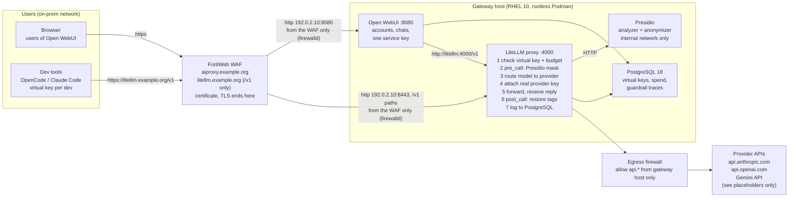

# LiteLLM + Presidio + PostgreSQL gateway

Private, on-prem LLM gateway: the company holds the provider API keys, users hold only
LiteLLM virtual keys, and every prompt is PII-masked by Presidio before it leaves the
network and restored on the way back.

This repository is the single source of truth for the deployment: the configuration
that runs on the server, the scripts used to assess and verify it, and the record of
every security decision. Work is done phase by phase; each phase has a document in
`docs/` and is only started once the previous one is verified.

**Published copy.** The names and addresses in this repository are placeholders. The
organisation's domain is written as `example.org`, hosts carry generic names (`llmgw01`,
`ansible01`), the server and its neighbours sit in the documentation ranges of RFC 5737
(`192.0.2.0/24` for the gateway network, `198.51.100.0/24` for the admin, automation and
monitoring hosts), the administrator account is `sysadmin`, and the person named in the
masking demonstrations is fictitious. Every measurement, hash, error message and decision
is recorded as it happened; only the identifiers were substituted.

## Architecture



Prompt content at each hop, for the input `"Jane Doe"`:

| Hop | Content |
|-----|---------|
| client to LiteLLM | `Jane Doe` (raw) |
| LiteLLM to provider | `<PERSON_1>` (masked) |
| provider to LiteLLM | `<PERSON_1>` (provider only ever sees the tag) |
| LiteLLM to client | `Jane Doe` (restored) |

## Components and pinned versions

| Component | Image | Notes |
|-----------|-------|-------|
| LiteLLM proxy | `ghcr.io/berriai/litellm-non_root:v1.100.1` | non-root (uid 65534), cosign-signed, 4 GiB / 2 CPUs (6 GiB until 2026-09-17) |
| Presidio analyzer | `ghcr.io/data-privacy-stack/presidio-analyzer:2.2.364` | non-root (uid 1001), spaCy `en_core_web_lg`, 3 workers, 5 GiB / 3 CPUs |
| Presidio anonymizer | `ghcr.io/data-privacy-stack/presidio-anonymizer:2.2.364` | non-root (uid 1001), 1 GiB / 1 CPU |
| PostgreSQL | `docker.io/library/postgres:18.6` | uid 999 (host user `llmgw` via keep-id), data at `/opt/llm-gateway/postgres/data`, 1.5 GiB / 1 CPU |
| Open WebUI | `ghcr.io/open-webui/open-webui:v0.11.3` | uid 0 in the container (host user `llmgw`), no capabilities, own database in the PostgreSQL container, data at `/opt/llm-gateway/openwebui/data`, 2 GiB / 1 CPU |

Every image is pinned by its `linux/amd64` manifest digest on the `Image=` line of its
unit; `deploy/opt/bin/images.tsv` maps each pin to the multi-arch index it comes from
(D-13, D-18). Runtime: Podman 5, rootless, Quadlet units under the `llmgw` user's
systemd manager, on RHEL 10 (D-11). Images are pulled on the server by pinned digest;
the deployment tree travels from the workstation by `scp`. Provider: Google Gemini (D-29)
once its key exists; until then OpenRouter's free tier serves as the testing provider
(D-31, docs/05 §5.7a). `api.anthropic.com` and `api.openai.com` in the diagram are
examples of further entries.
Presidio's images moved from `mcr.microsoft.com` to `ghcr.io/data-privacy-stack` in 2026;
older tutorials still reference the Microsoft registry.

## Phases

| # | Phase | Document | Status |
|---|-------|----------|--------|
| 0 | Repository and reference material | this file, `DECISIONS.md` | done |
| 1 | Server assessment (read-only) | `docs/01-server-assessment.md`, `scripts/assess.sh` | done 2026-09-14; the questions of §1.3 answered in §1.14 (2026-09-15), SSH source ranges still open |
| 2 | Host hardening (RHEL 10): SELinux, SSH, firewalld, egress | `docs/02-hardening.md`, `deploy/host/` | SELinux enforcing 2026-09-16 (§4.5); SSH, sysctl, firewalld, egress deferred (D-22) |
| 3 | Package source, Podman, service account, /opt tree, images | `docs/03-podman-install.md`, `scripts/verify-pins.sh`, `deploy/opt/bin/` | done 2026-09-16 |
| 4 | Deploy the stack (Quadlet) | `docs/04-deploy.md`, `deploy/opt/` | done 2026-09-16; audit rules and reboot test wait for the patch window (§4.5) |
| 5 | Validation: health, keys, masking end to end (mock model) | `docs/05-validation.md` | 5.1 to 5.6, 5.8, 5.9 pass 2026-09-16; 5.7 passed 2026-09-17 with the testing provider (§5.7a); 5.10 (port 4000 on the LAN) belongs to the exposure work |
| 6 | Operations: backups, updates, rotation | `docs/06-operations.md` | procedures written; **next**: first dump with restore test (§6.1) and routine checks (§6.2); schedule and off-host copy wait for D-28 |
| 7 | Provider choice, key, real round trip | `docs/05-validation.md` §5.7 | Gemini chosen 2026-09-16 (D-29), key not yet obtained; OpenRouter free tier as testing provider (`nemotron-3-super`) since 2026-09-17, round trip through the browser verified (D-31, §5.7a); Gemini steps wait for the key |
| 8 | Open WebUI for the users | `docs/07-openwebui.md`, `deploy/opt/openwebui/` | deployed 2026-09-17 (D-30, D-32), masking round trip through the browser verified; on `nemotron-3-super` since §5.7a; exposure is phase 9 |
| 9 | Exposure through the FortiWeb WAF: `aiproxy.example.org`, `litellm.example.org`, firewalld | `docs/08-exposure.md` | written 2026-09-17, WAF procedure verified against the FortiWeb guides and the LiteLLM name added on request 2026-09-18 (D-33); §8.3 and §8.2 run 2026-09-18 (firewalld up, both front-ends published on the host address, reachable from the WAF address only); the path from the WAF to the server passes 443, 8080 and 8443 only, so LiteLLM is published on host port 8443 (D-33 amendment 3); Open WebUI WAF objects built and verified by curl through the VIP 2026-09-18; FORWARDED_ALLOW_IPS corrected to the backend subnet (rootlessport peer, D-33 amendment 4), installed and proven the same day; DNS records created 2026-09-21; the browser's `500: Internal Error` traced to the WAF's zstd handling and closed by `ENABLE_COMPRESSION_MIDDLEWARE=false` (D-33 amendment 5), login page loads through the WAF; **open**: §8.4 login and name test, §8.6 change request to the WAF administrator (X-Forwarded-For rule, `chunk-encoding enable`, zstd report, dedicated `sp-openwebui`, HSTS), the LiteLLM WAF objects (§8.1 steps 13 to 19) and its A record |
| later | SSH source ranges, egress policy, Active Directory login, signatures on the LiteLLM policy, front-end findings | `docs/08-exposure.md` §8.5, `docs/07-openwebui.md` §7.8, D-22 | open |

**Project status, 2026-09-21 (owner decision):** closed as complete for the users' path.
The deployed configuration carries no workaround: every setting in `deploy/` is the one
the sources call for, and each deviation from a default is a recorded decision. Open
items stay listed above and in `docs/08-exposure.md` §8.5 and §8.6 as a register, not
as blockers: the X-Forwarded-For rule and `chunk-encoding` on the WAF (client address in
the logs, streaming), the LiteLLM WAF policy, the D-22 host items (SSH key-only login,
sysctl, SSH source ranges, egress policy), the first backup with a restore test, and the
provider key (the gateway runs on the OpenRouter free tier until the Gemini key exists).

## Repository layout

```
deploy/
  opt/                      mirror of /opt/llm-gateway on the server (copied with scp)
    litellm/                llmgw-litellm.container, config.yaml, litellm.env.example
    presidio/               llmgw-presidio-analyzer.container, llmgw-presidio-anonymizer.container
    postgres/               llmgw-postgres.container, postgres.env.example
    openwebui/              llmgw-openwebui.container, openwebui.env.example
    network/                llmgw-backend.network (internal), llmgw-egress.network
    bin/                    images.tsv (pins), litellm-cosign.pub, pull-images.sh, link-quadlets.sh
  llmgw/storage.conf        ~llmgw/.config/containers/storage.conf (image store under /opt)
  host/                     sshd drop-in, sysctl, audit rules, nftables egress policy (-> /etc)
scripts/
  assess.sh                 read-only host assessment (server)
  verify-pins.sh            workstation: cosign + index check when a pin is chosen or changed
docs/                       one document per phase
reports/                    assessment output (git-ignored)
DECISIONS.md                security decisions and their rationale
```

On the server (`/opt` as required, D-12):

```
/opt/llm-gateway/                root:llmgw 0750
  litellm/                       unit, config.yaml, litellm.env (0600)
  presidio/                      units (stateless; analyzer configuration later)
  postgres/                      unit, postgres.env (0600), data/ (0700), backups/
  openwebui/                     unit, openwebui.env (0600), data/ (uploads, vector store)
  network/                       the two network units
  bin/                           scripts, image table, cosign key
  storage/                       Podman image store of llmgw (graphroot)
/home/llmgw/.config/containers/systemd/*   symlinks to the units above (Quadlet search path)
/home/llmgw/.config/containers/storage.conf
```

## Working agreement

- Nothing is applied to the server that is not in this repository first.
- Secrets (`/opt/llm-gateway/*/*.env`) are created on the server and never committed;
  templates are.
- The repository is the log and the source: change a file here, commit, `scp` it to the
  server, install it in place as `llmgw`, then reload/restart the unit. The server never
  talks to GitHub.
- Each phase ends with an explicit verification step before the next one starts.
