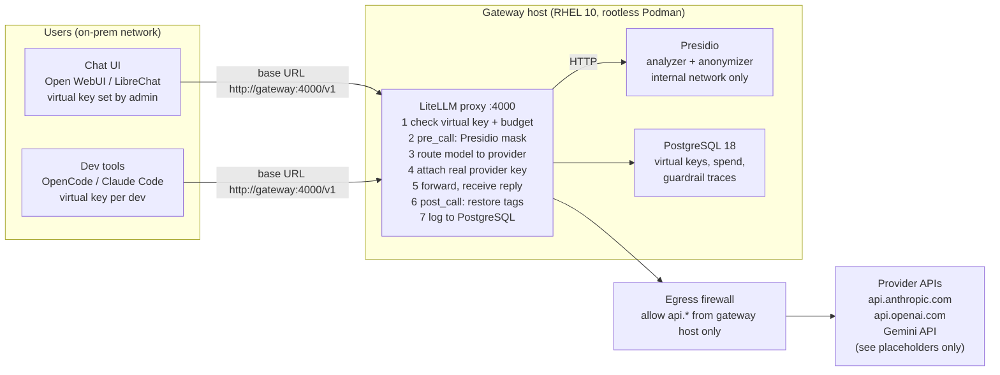

# LiteLLM + Presidio + PostgreSQL gateway

Private, on-prem LLM gateway: the company holds the provider API keys, users hold only
LiteLLM virtual keys, and every prompt is PII-masked by Presidio before it leaves the
network and restored on the way back.

This repository is the single source of truth for the deployment: the configuration
that runs on the server, the scripts used to assess and verify it, and the record of
every security decision. Work is done phase by phase; each phase has a document in
`docs/` and is only started once the previous one is verified.

## Architecture



Prompt content at each hop, for the input `"Dennis Yurichev"`:

| Hop | Content |
|-----|---------|
| client to LiteLLM | `Dennis Yurichev` (raw) |
| LiteLLM to provider | `<PERSON_1>` (masked) |
| provider to LiteLLM | `<PERSON_1>` (provider only ever sees the tag) |
| LiteLLM to client | `Dennis Yurichev` (restored) |

## Components and pinned versions

| Component | Image | Notes |
|-----------|-------|-------|
| LiteLLM proxy | `ghcr.io/berriai/litellm-non_root:v1.100.1` | non-root (uid 65534), cosign-signed, Prisma toolchain baked in |
| Presidio analyzer | `ghcr.io/data-privacy-stack/presidio-analyzer:2.2.364` | non-root (uid 1001), spaCy `en_core_web_lg` |
| Presidio anonymizer | `ghcr.io/data-privacy-stack/presidio-anonymizer:2.2.364` | non-root (uid 1001) |
| PostgreSQL | `docker.io/library/postgres:18.6` | run as uid 999 (host user `llmgw` via keep-id), data at `/opt/llm-gateway/data/postgres` |

Every image is additionally pinned by digest on the `Image=` line of its unit in
`deploy/quadlet/`. Runtime: Podman 5 (rootless, Quadlet units under the `llmgw` user's
systemd manager) on RHEL 10; see DECISIONS.md D-11 for why not Docker.
Presidio's images moved from `mcr.microsoft.com` to `ghcr.io/data-privacy-stack` in 2026;
older tutorials still reference the Microsoft registry.

## Phases

| # | Phase | Document | Status |
|---|-------|----------|--------|
| 0 | Repository and reference material | this file, `DECISIONS.md` | done |
| 1 | Server assessment (read-only) | `docs/01-server-assessment.md`, `scripts/assess.sh` | **in progress** (§1.5 lists what is known and what is left) |
| 2 | Host hardening (RHEL 10) | `docs/02-hardening.md`, `deploy/host/` | pending |
| 3 | Podman, service account, cosign, image verification | `docs/03-podman-install.md`, `scripts/verify-images.sh` | pending |
| 4 | Deploy the stack (Quadlet) | `docs/04-deploy.md`, `deploy/quadlet/` | pending |
| 5 | Validation: health, keys, masking end to end | `docs/05-validation.md` | pending |
| 6 | Operations: backups, updates, rotation | `docs/06-operations.md` | pending |
| later | TLS termination, SSO for the admin UI, client onboarding | to be decided after phase 5 | open |

## Repository layout

```
deploy/
  quadlet/                  the stack: one .container unit per service + two .network units,
                            digest-pinned, hardened (rootless Podman, systemd user manager)
  litellm/config.yaml       LiteLLM models, guardrail, settings (bind-mounted read-only)
  env/*.env.example         secret templates (installed to /opt/llm-gateway/env/, never committed)
  host/                     sshd drop-in, sysctl, audit rules, nftables egress policy
  cosign/                   vendored LiteLLM image signing key + provenance
scripts/
  assess.sh                 read-only host assessment -> reports/
  verify-images.sh          pull by digest + cosign verify (run as llmgw)
docs/                       one document per phase
reports/                    assessment output (git-ignored)
DECISIONS.md                security decisions and their rationale
```

On the server (`/opt` as required, D-12):

```
/opt/llm-gateway/                root:llmgw 0750
  repo/                          this repository, checked out as llmgw (source of truth)
  env/postgres.env, litellm.env  secrets, llmgw 0600
  data/postgres/                 PostgreSQL data, llmgw 0700 (uid 999 inside the container)
/home/llmgw/.config/containers/systemd -> /opt/llm-gateway/repo/deploy/quadlet   (Quadlet search path)
/home/llmgw/.local/share/containers/   image storage (cache; rebuilt by verify-images.sh)
```

## Working agreement

- Nothing is applied to the server that is not in this repository first.
- Secrets (`/opt/llm-gateway/env/*.env`) are never committed; templates are.
- The server runs a reviewed commit of this repository: change here, commit, `git pull`
  as `llmgw`, then reload/restart the unit.
- Each phase ends with an explicit verification step before the next one starts.
