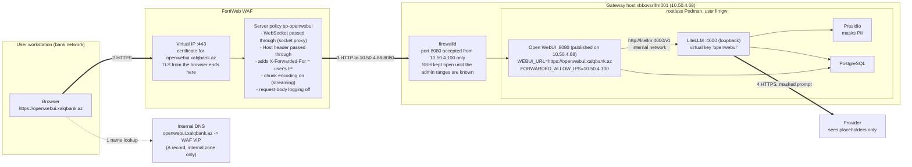

# Phase 9: Exposure through the WAF, openwebui.xalqbank.az

Until now both front-ends were reached through SSH tunnels. This phase puts Open WebUI
behind the bank's FortiWeb WAF under the name `openwebui.xalqbank.az` (D-33). The WAF is
the reverse proxy: it holds the certificate, terminates the users' TLS and forwards to
the server over plain HTTP on the WAF-to-server leg, which firewalld restricts to the
WAF's address. Nothing new runs on the server. `litellm.xalqbank.az` is the second step
of the same design and waits for the first developer key (D-33; docs/05 §5.10).

Addresses: server `10.50.4.68`; WAF address `10.50.4.100`, meaning the FortiWeb interface
from which it opens the connections to the server (in Reverse Proxy mode the source of the
server-side connection is a FortiWeb interface address, not the virtual IP the users
reach). §8.3 checks this on the server.



Where the prompt exists unmasked: the WAF (TLS ends there), Open WebUI's chat history
(D-30), LiteLLM before the Presidio call. Nothing outside the bank sees it.

## 8.1 The WAF (FortiWeb web UI, then two CLI lines)

Verified 2026-09-18 against the FortiWeb 7.6.7 Administration Guide and the 7.4.5 CLI
Reference (Fortinet's PDFs; the object names and menu paths below are theirs). The
firmware on the bank's unit is read from System > Status before starting; the 7.x
releases share these menus. Everything is built as separate objects first and tied
together by the server policy last, which is the order the guide prescribes. Object
names are proposals.

What the objects give, in one list: TLS on 443 with the bank's certificate and chain,
plain HTTP to `10.50.4.68:8080` with a `GET /health` check, the `Host` header passed
through, `X-Forwarded-For` and `X-Forwarded-Proto` set by the WAF alone, WebSocket
passed through (FortiWeb "acts as a pure socket proxy for WebSocket traffic"), streamed
answers forwarded chunk by chunk, 20 MB request bodies, no request-body logging.

**Before touching the WAF, three things from other teams**

- A free address on the FortiWeb's client-facing subnet for the virtual IP (it must not
  be an interface address). The DNS A record points at it later.
- The bank CA signs a server certificate for `openwebui.xalqbank.az` from a CSR (step 7).
- Confirmation that the FortiWeb runs in Reverse Proxy mode (System > Config >
  Operation). It does if it already publishes other applications this way. Never change
  the mode for this project: switching deletes the policies of the old mode.

**Step 1, virtual IP.** Network > Virtual IP > Create New: Name `vip-openwebui`, IPv4
Address = the allocated address with its mask, Interface = the client-facing port. Only a
global administrator can create VIPs.

**Step 2, virtual server.** Server Objects > Server > Virtual Server > Create New, Name
`vs-openwebui`, OK; then Create New inside it: Use Interface IP off, Virtual IP
`vip-openwebui`, Status enabled, OK. The listening port is not set here but by the
service chosen in the server policy (step 10).

**Step 3, health check.** Server Objects > Server > Health Check > Create New: Name
`hc-openwebui`, Relationship And, OK; rule: Type HTTP, URL Path `/health`, Method GET,
Match Type Response Code, Response Code `200`, Timeout 3, Retry Times 3, Interval 10
(the guide's defaults; interval between 6 and 9 s is its recommendation for timeout 3
and 2 retries, 10 is fine). Open WebUI answers `{"status":true}` with 200 (docs/07).

**Step 4, server pool.** Server Objects > Server > Server Pool > Create New > Create HTTP
Server Pool: Name `pool-openwebui`, Type follows the operation mode (Reverse Proxy),
Single Server/Server Balance = **Server Balance**, Server Health Check `hc-openwebui`,
Load Balancing Algorithm Round Robin, Persistence none, OK. Server Balance with one
member is chosen because the guide offers the health check (pool and member level)
only for Server Balance pools; a Single Server pool has no health check and the Policy
Status dashboard shows nothing for it. Then Create New member: Status Enable, Server
Type IP, IP `10.50.4.68`, Port `8080`, SSL off, HTTP/2 off, Proxy Protocol off, Inherit
Health Check on, Backup Server off, OK. The member shows down until §8.3 is done on the
server; that is expected.

**Step 5, protected hostname.** Server Objects > Protected Hostnames > Create New: Name
`ph-openwebui`, Default Action Deny, OK; Create New entry: Host `openwebui.xalqbank.az`,
Ignore Port off, Override Headers off, Action Accept, OK. Requests whose `Host` is not
this name are rejected before reaching the server (the attack log then shows
`HTTP Host Violation`).

**Step 6, X-header rule.** Server Objects > X-Forwarded-For > Create New: Name
`xff-openwebui`; Add X-Forwarded-For **on**; Add Source Port off; Add X-Forwarded-Port
off; Add X-Real-IP off; Add X-Forwarded-Proto **on**; Delete Previous XFF Headers
**on** (the request then carries exactly one `X-Forwarded-For` with one address,
written by the WAF, so a client cannot pre-load the header); Merge Previous XFF Headers
off; Use X-Header to Identify Original Client's IP **off** (the users connect to the
WAF directly, nothing applies NAT in front of it), OK. The rule takes effect only when
selected in the protection profile (step 9).

**Step 7, certificate.** Server Objects > Certificates > Local > Generate: Certification
Name `openwebui.xalqbank.az`, ID Type Domain Name, Domain Name `openwebui.xalqbank.az`,
Organization and Country as the bank's PKI requires, Subject Alternative Names
`openwebui.xalqbank.az`, Key Type RSA, Key Size 2048 Bit, Digest Algorithm SHA256,
Enrollment Method File Based, OK. Select the PENDING row, Download, and submit the
`.csr` to the bank CA (server authentication). The private key stays on the WAF. When
the signed certificate (PEM) comes back: Local > Import, Type **Local Certificate**
(the CSR was generated here, so no key file is asked), Certificate file = the signed
certificate, OK; the row turns from PENDING to a certificate. If the issuing CA is an
intermediate, upload its certificate (or one PEM file holding the whole chain in order,
issuer first) under Server Objects > Certificates > Intermediate CA > Import > Local PC,
then on the Intermediate CA Group tab create `ca-group-bank` and add it. If the PKI
team prefers to issue certificate and key themselves as a PKCS#12 file, Import with
Type PKCS12 Certificate and its password instead of the CSR route.

**Step 8, protocol constraints.** Web Protection > Protocol > HTTP Protocol
Constraints: clone the predefined profile into `hpc-openwebui` and edit: Body Length
enabled with `20971520` (20 MB, document uploads; the effective upload limit, Open WebUI
sets none), Content Length `20971520`, HTTP Request Length not lower than that if it is
enabled; **WebSocket Protocol must stay off** (that constraint detects and, with a deny
action, blocks WebSocket upgrades; socket.io lives under `/ws/`); Illegal HTTP Version
on (HTTP/1.1 is what the browsers use once HTTP/2 stays off in step 10).

**Step 9, inline protection profile.** Policy > Web Protection Profile > Inline
Protection Profile: clone a predefined profile into `wpp-openwebui` and set: Signatures
= the signature set the clone brought; HTTP Protocol Constraints `hpc-openwebui`;
X-Forwarded-For `xff-openwebui`; WebSocket Security empty (a security policy is
optional; without one the WAF proxies the socket); Bot Mitigation Policy **empty** (its
Slow Attack Detection carries a 60 s HTTP transaction timeout by default, which would
cut long answers); Client Management off; Allow Method, URL Access, Custom Policy, JSON
Protection empty for now. Everything else as cloned.

**Step 10, server policy.** Policy > Server Policy > Create New:

- Network Configuration: Policy Name `sp-openwebui`; Deployment Mode Single
  Server/Server Balance; Virtual Server `vs-openwebui`; Server Pool `pool-openwebui`;
  Protected Hostnames `ph-openwebui`; Client Real IP **off** (the server must see the
  WAF's address, §8.3 depends on it); HTTP Service `HTTP` only if the redirect below is
  wanted; HTTPS Service `HTTPS`; HTTP/2 **off** (default; HTTP/2 bypasses the WebSocket
  services and is the setting behind the reported hangs of `text/event-stream`
  responses); Certificate Type Local, Certificate `openwebui.xalqbank.az`, Certificate
  Intermediate Group `ca-group-bank` if created.
- Advanced SSL settings: Supported SSL Protocols TLS 1.2 and TLS 1.3 only; SSL/TLS
  Encryption Level High; Disable Client-Initiated SSL Renegotiation on; Add HSTS Header
  on with Max. Age 31536000 (the guide requires a web protection profile on the policy
  for HSTS, which step 9 provides); Redirect HTTP to HTTPS on when the HTTP service is
  selected.
- Application Delivery: Retry On off; Web Cache off.
- Security Configuration: **Monitor Mode on for the burn-in** (see below); Syn Cookie
  off; Web Protection Profile `wpp-openwebui`; URL Case Sensitivity on.
- Log Config: Enable Traffic Log off. OK. The policy is enabled on creation.

**Step 11, streaming (CLI, the one setting the web UI does not show).** By default
FortiWeb decodes a chunked response and forwards it as one body with a
`Content-Length`, that is, the answer would reach the browser only when the model has
finished. `chunk-encoding enable` makes it forward the chunks as they arrive:

```
config server-policy policy
  edit "sp-openwebui"
    set chunk-encoding enable
  next
end
show server-policy policy sp-openwebui
```

`client-timeout`, `HTTP-header-timeout` and `tcp-recv-timeout` keep their default 0 (no
timeout), so a long generation is not cut by the policy.

**Step 12, checks on the WAF.** CLI `execute ping 10.50.4.68`, and after §8.3
`execute telnettest 10.50.4.68:8080` prints `Connected`; the Policy Status dashboard
shows the pool member up. Log & Report > Log Config > Other Log Settings: Enable Attack
Log on, traffic log stays off (`config log traffic-log`, `status` and `packet-log`
default to disable, nothing to change). Retain Packet Payload For: keep the defaults
during the burn-in, because the first 4 KB of a request that matched a signature is what
shows a false positive; once tuned, clear the Signatures entry so that prompt text stops
landing in the attack log (D-33).

**Burn-in.** Prompts contain SQL, shell and code fragments, which is exactly what the
signature set looks for in a request body, so false positives on `/api/chat/completions`
are expected. With Monitor Mode on, violations are logged (Log & Report > Log Access >
Attack) and nothing is blocked. After a week of use: add signature exceptions for the
matching URLs where the log shows them, then switch Monitor Mode off and re-test. The
WAF protections that matter for this application are the TLS termination, the host
restriction and the size limits; the signatures are a bonus to be tuned, not a reason to
block the users' chats.

**DNS.** One A record `openwebui.xalqbank.az` pointing at the virtual IP of step 1, in the
internal zone only, created after step 12 passes. The server's own address is not
published under this name.

## 8.2 The unit (workstation, then service account)

Three lines changed in `deploy/opt/openwebui/llmgw-openwebui.container`:
`PublishPort=10.50.4.68:8080:8080`, `WEBUI_URL=https://openwebui.xalqbank.az`, and two
new variables `FORWARDED_ALLOW_IPS=10.50.4.100` and `WEBUI_SESSION_COOKIE_SECURE=true`
(both read by v0.11.3: `start.sh` passes the first to uvicorn as `--forwarded-allow-ips`,
whose default is `*`; `env.py` applies the second to the session cookie and, by
inheritance, the auth cookie). Transfer the file with the branch ZIP and `scp`
(docs/03 §3.4) and check it on the server:

```bash
infosec$ grep -c $'\r' /tmp/llmgw-openwebui.container; sudo diff /opt/llm-gateway/openwebui/llmgw-openwebui.container /tmp/llmgw-openwebui.container
infosec$ sudo install -m 644 -o llmgw -g llmgw /tmp/llmgw-openwebui.container /opt/llm-gateway/openwebui/llmgw-openwebui.container && rm /tmp/llmgw-openwebui.container
```

CRLF count 0; the diff shows the `PublishPort=`, `WEBUI_URL=` lines, the two new
variables and their comments, and the header comment, nothing else. Then, as `llmgw`
(`sudo machinectl shell llmgw@`):

```bash
llmgw$ systemctl --user daemon-reload && systemctl --user restart llmgw-openwebui.service
llmgw$ podman ps --format '{{.Names}}\t{{.Status}}'
llmgw$ podman port openwebui
```

All five containers healthy; `podman port` shows `8080/tcp -> 10.50.4.68:8080`. From the
admin account, `sudo ss -tlnp | grep ':8080 '` shows the socket on 10.50.4.68, no longer
on 127.0.0.1. The SSH tunnel to 8080 stops working at this point; the LiteLLM tunnel to
4000 is unaffected.

## 8.3 firewalld (admin account)

This is the docs/02 §2.7 step, executed now. The admin ranges for SSH are still
unknown (docs/01 §1.14 question 5), so the `ssh` service stays allowed from anywhere,
which is what the host does today without a firewall; the SSH rich rules of §2.7 follow
when the ranges are known. The Zabbix rule from §2.7 is included so that monitoring
keeps working. Port 8080 is accepted from the WAF only.

```bash
sudo systemctl enable --now firewalld
sudo firewall-cmd --get-default-zone                    # public
sudo firewall-cmd --permanent --zone=public --remove-service=cockpit
sudo firewall-cmd --permanent --zone=public --remove-service=dhcpv6-client
sudo firewall-cmd --permanent --zone=public --add-rich-rule='rule family="ipv4" source address="10.100.7.150/32" port port="10050" protocol="tcp" accept'
sudo firewall-cmd --permanent --zone=public --add-rich-rule='rule family="ipv4" source address="10.50.4.100/32" port port="8080" protocol="tcp" accept'
sudo firewall-cmd --reload && sudo firewall-cmd --list-all
```

`--list-all` shows `services: ssh`, the two rich rules, no `ports:`. The rule does not
affect traffic the host sends to itself (firewalld accepts the loopback interface), so
`curl -sS http://10.50.4.68:8080/health` from the server still answers; the test of the
rule is from the workstation:

```
curl.exe -sS -m 5 http://10.50.4.68:8080/health
```

must fail (the `public` zone rejects with "No route to host" or times out), while the
WAF's health check turns the pool member up once §8.1 step 4 is in place.

If the member stays down, the WAF is not connecting from 10.50.4.100. firewalld can say
which address it is: enable the denied-packet log, wait one health check interval,
read the kernel log, then switch the log off again:

```bash
sudo firewall-cmd --set-log-denied=unicast
sudo journalctl -k --since -1m -g 'DPT=8080' | tail -3
sudo firewall-cmd --set-log-denied=off
```

The `SRC=` field of a logged line is the FortiWeb interface address actually used; if
it differs from 10.50.4.100, the rich rule and `FORWARDED_ALLOW_IPS` in the unit (§8.2)
are corrected to that address, not the other way round.

## 8.4 Round trip (workstation, browser)

1. `https://openwebui.xalqbank.az/` shows the login page with a valid certificate (the
   padlock names the WAF's CA), no warning.
2. Log in as the admin, send the docs/07 §7.6 name test; the answer streams token by
   token (`chunk-encoding enable`, §8.1 step 11) and the placeholders come back restored.
3. Admin Panel, Settings, General shows the WebUI URL as `https://openwebui.xalqbank.az`.
4. On the server, the request arrived from the WAF, the user's address in the header:

   ```bash
   sudo journalctl _SYSTEMD_USER_UNIT=llmgw-openwebui.service --since -5m | grep -E '"(GET|POST) ' | tail -3
   ```

   uvicorn's access lines show the client address from `X-Forwarded-For` (the
   workstation's address), not 10.50.4.100, which proves `FORWARDED_ALLOW_IPS` works.
5. Sign out and in again: the cookie is accepted (Secure flag, HTTPS).

## 8.5 Exit criteria and what comes next

- 8.2 to 8.4 pass; results recorded below.
- The tunnel to 8080 is retired from docs/07 §7.6 for daily use; the LiteLLM admin UI
  keeps its tunnel (docs/05 §5.8).

Next, in this order: `litellm.xalqbank.az` when the first developer key exists (same
steps with port 4000, `general_settings.use_x_forwarded_for: true` in `config.yaml`, and
the WAF exposing `/v1/` only), the SSH rich rules once the admin ranges are known
(docs/02 §2.7), the egress policy (docs/02 §2.8), Active Directory login.

## Results

Not yet run.
