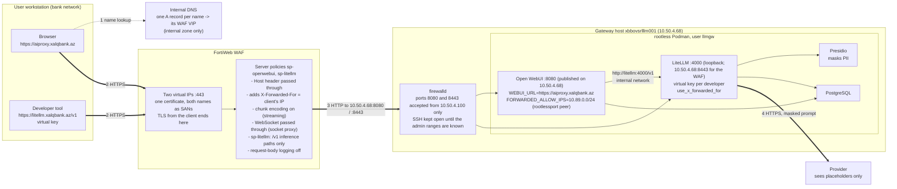

# Phase 9: Exposure through the WAF, aiproxy.xalqbank.az and litellm.xalqbank.az

Until now both front-ends were reached through SSH tunnels. This phase puts them behind
the bank's FortiWeb WAF: Open WebUI as `aiproxy.xalqbank.az` for the users, LiteLLM as
`litellm.xalqbank.az` for developer tools with a virtual key each (D-33; the LiteLLM
name was added on request on 2026-09-18, docs/05 §5.10). The WAF is the reverse proxy:
it holds the certificate, terminates the TLS and forwards to the server over plain HTTP
on the WAF-to-server leg, which firewalld restricts to the WAF's address. For LiteLLM the
WAF passes the inference paths only (`/v1/chat/completions`, `/v1/models`, ...); the
admin UI and the management API stay on the SSH tunnel. Nothing new runs on the server.

Addresses: server `10.50.4.68`; WAF address `10.50.4.100`, meaning the FortiWeb interface
from which it opens the connections to the server (in Reverse Proxy mode the source of the
server-side connection is a FortiWeb interface address, not the virtual IP the users
reach). §8.3 checks this on the server.



Where the prompt exists unmasked: the WAF (TLS ends there), Open WebUI's chat history
(D-30), LiteLLM before the Presidio call. Nothing outside the bank sees it.

## 8.1 The WAF (FortiWeb web UI, then two CLI lines)

Verified 2026-09-18 against the FortiWeb 7.6.7 Administration Guide and the 7.4.5 CLI
Reference (Fortinet's PDFs; the object names and menu paths below are theirs). The
firmware on the bank's unit is read from System > Status before starting; the 7.x
releases share these menus. Everything is built as separate objects first and tied
together by the server policy last, which is the order the guide prescribes. Object
names are proposals.

What the objects give, in one list: TLS on 443 with the bank's certificate and chain,
plain HTTP to `10.50.4.68:8080` with a `GET /health` check, the `Host` header passed
through, `X-Forwarded-For` and `X-Forwarded-Proto` set by the WAF alone, WebSocket
passed through (FortiWeb "acts as a pure socket proxy for WebSocket traffic"), streamed
answers forwarded chunk by chunk, 20 MB request bodies, no request-body logging.

**Before touching the WAF, three things from other teams**

- A free address on the FortiWeb's client-facing subnet for the virtual IP (it must not
  be an interface address). The DNS A record points at it later.
- The bank CA signs a server certificate for `aiproxy.xalqbank.az` from a CSR (step 7).
- Confirmation that the FortiWeb runs in Reverse Proxy mode (System > Config >
  Operation). It does if it already publishes other applications this way. Never change
  the mode for this project: switching deletes the policies of the old mode.

**Step 1, virtual IP.** Network > Virtual IP > Create New: Name `vip-openwebui`, IPv4
Address = the allocated address with its mask, Interface = the client-facing port. Only a
global administrator can create VIPs.

**Step 2, virtual server.** Server Objects > Server > Virtual Server > Create New, Name
`vs-openwebui`, OK; then Create New inside it: Use Interface IP off, Virtual IP
`vip-openwebui`, Status enabled, OK. The listening port is not set here but by the
service chosen in the server policy (step 10).

**Step 3, health check.** Server Objects > Server > Health Check > Create New: Name
`hc-openwebui`, Relationship And, OK; rule: Type HTTP, URL Path `/health`, Method GET,
Match Type Response Code, Response Code `200`, Timeout 3, Retry Times 3, Interval 10
(the guide's defaults; interval between 6 and 9 s is its recommendation for timeout 3
and 2 retries, 10 is fine). Open WebUI answers `{"status":true}` with 200 (docs/07).

**Step 4, server pool.** Server Objects > Server > Server Pool > Create New > Create HTTP
Server Pool: Name `pool-openwebui`, Type follows the operation mode (Reverse Proxy),
Single Server/Server Balance = **Server Balance**, Server Health Check `hc-openwebui`,
Load Balancing Algorithm Round Robin, Persistence none, OK. Server Balance with one
member is chosen because the guide offers the health check (pool and member level)
only for Server Balance pools; a Single Server pool has no health check and the Policy
Status dashboard shows nothing for it. Then Create New member: Status Enable, Server
Type IP, IP `10.50.4.68`, Port `8080`, SSL off, HTTP/2 off, Proxy Protocol off, Inherit
Health Check on, Backup Server off, OK. The member shows down until §8.3 is done on the
server; that is expected.

**Step 5, protected hostname.** Server Objects > Protected Hostnames > Create New: Name
`ph-openwebui`, Default Action Deny, OK; Create New entry: Host `aiproxy.xalqbank.az`,
Ignore Port off, Override Headers off, Action Accept, OK. Requests whose `Host` is not
this name are rejected before reaching the server (the attack log then shows
`HTTP Host Violation`).

**Step 6, X-header rule.** Server Objects > X-Forwarded-For > Create New: Name
`xff-openwebui`; Add X-Forwarded-For **on**; Add Source Port off; Add X-Forwarded-Port
off; Add X-Real-IP off; Add X-Forwarded-Proto **on**; Delete Previous XFF Headers
**on** (the request then carries exactly one `X-Forwarded-For` with one address,
written by the WAF, so a client cannot pre-load the header); Merge Previous XFF Headers
off; Use X-Header to Identify Original Client's IP **off** (the users connect to the
WAF directly, nothing applies NAT in front of it), OK. The rule takes effect only when
selected in the protection profile (step 9).

**Step 7, certificate.** Server Objects > Certificates > Local > Generate: Certification
Name `aiproxy.xalqbank.az`, ID Type Domain Name, Domain Name `aiproxy.xalqbank.az`,
Organization and Country as the bank's PKI requires, Subject Alternative Names
`aiproxy.xalqbank.az` and `litellm.xalqbank.az` (one certificate serves both server
policies and is renewed once), Key Type RSA, Key Size 2048 Bit, Digest Algorithm SHA256,
Enrollment Method File Based, OK. Select the PENDING row, Download, and submit the
`.csr` to the bank CA (server authentication). The private key stays on the WAF. When
the signed certificate (PEM) comes back: Local > Import, Type **Local Certificate**
(the CSR was generated here, so no key file is asked), Certificate file = the signed
certificate, OK; the row turns from PENDING to a certificate. If the issuing CA is an
intermediate, upload its certificate (or one PEM file holding the whole chain in order,
issuer first) under Server Objects > Certificates > Intermediate CA > Import > Local PC,
then on the Intermediate CA Group tab create `ca-group-bank` and add it. If the PKI
team prefers to issue certificate and key themselves as a PKCS#12 file, Import with
Type PKCS12 Certificate and its password instead of the CSR route.

**Step 8, protocol constraints.** Web Protection > Protocol > HTTP Protocol
Constraints: clone the predefined profile into `hpc-openwebui` and edit: Body Length
enabled with `20971520` (20 MB, document uploads; the effective upload limit, Open WebUI
sets none), Content Length `20971520`, HTTP Request Length not lower than that if it is
enabled; **WebSocket Protocol must stay off** (that constraint detects and, with a deny
action, blocks WebSocket upgrades; socket.io lives under `/ws/`); Illegal HTTP Version
on (HTTP/1.1 is what the browsers use once HTTP/2 stays off in step 10).

**Step 9, inline protection profile.** Policy > Web Protection Profile > Inline
Protection Profile: clone a predefined profile into `wpp-openwebui` and set: Signatures
= the signature set the clone brought; HTTP Protocol Constraints `hpc-openwebui`;
X-Forwarded-For `xff-openwebui`; WebSocket Security empty (a security policy is
optional; without one the WAF proxies the socket); Bot Mitigation Policy **empty** (its
Slow Attack Detection carries a 60 s HTTP transaction timeout by default, which would
cut long answers); Client Management off; Allow Method, URL Access, Custom Policy, JSON
Protection empty for now. Everything else as cloned.

**Step 10, server policy.** Policy > Server Policy > Create New:

- Network Configuration: Policy Name `sp-openwebui`; Deployment Mode Single
  Server/Server Balance; Virtual Server `vs-openwebui`; Server Pool `pool-openwebui`;
  Protected Hostnames `ph-openwebui`; Client Real IP **off** (the server must see the
  WAF's address, §8.3 depends on it); HTTP Service `HTTP` only if the redirect below is
  wanted; HTTPS Service `HTTPS`; HTTP/2 **off** (default; HTTP/2 bypasses the WebSocket
  services and is the setting behind the reported hangs of `text/event-stream`
  responses); Certificate Type Local, Certificate `aiproxy.xalqbank.az`, Certificate
  Intermediate Group `ca-group-bank` if created.
- Advanced SSL settings: Supported SSL Protocols TLS 1.2 and TLS 1.3 only; SSL/TLS
  Encryption Level High; Disable Client-Initiated SSL Renegotiation on; Add HSTS Header
  on with Max. Age 31536000 (the guide requires a web protection profile on the policy
  for HSTS, which step 9 provides); Redirect HTTP to HTTPS on when the HTTP service is
  selected.
- Application Delivery: Retry On off; Web Cache off.
- Security Configuration: **Monitor Mode on for the burn-in** (see below); Syn Cookie
  off; Web Protection Profile `wpp-openwebui`; URL Case Sensitivity on.
- Log Config: Enable Traffic Log off. OK. The policy is enabled on creation.

**Step 11, streaming (CLI, the one setting the web UI does not show).** By default
FortiWeb decodes a chunked response and forwards it as one body with a
`Content-Length`, that is, the answer would reach the browser only when the model has
finished. `chunk-encoding enable` makes it forward the chunks as they arrive:

```
config server-policy policy
  edit "sp-openwebui"
    set chunk-encoding enable
  next
end
show server-policy policy sp-openwebui
```

`client-timeout`, `HTTP-header-timeout` and `tcp-recv-timeout` keep their default 0 (no
timeout), so a long generation is not cut by the policy.

**Step 12, checks on the WAF.** CLI `execute ping 10.50.4.68`, and after §8.3
`execute telnettest 10.50.4.68:8080` prints `Connected`; the Policy Status dashboard
shows the pool member up. Log & Report > Log Config > Other Log Settings: Enable Attack
Log on, traffic log stays off (`config log traffic-log`, `status` and `packet-log`
default to disable, nothing to change). Retain Packet Payload For: keep the defaults
during the burn-in, because the first 4 KB of a request that matched a signature is what
shows a false positive; once tuned, clear the Signatures entry so that prompt text stops
landing in the attack log (D-33).

**Burn-in.** Prompts contain SQL, shell and code fragments, which is exactly what the
signature set looks for in a request body, so false positives on `/api/chat/completions`
are expected. With Monitor Mode on, violations are logged (Log & Report > Log Access >
Attack) and nothing is blocked. After a week of use: add signature exceptions for the
matching URLs where the log shows them, then switch Monitor Mode off and re-test. The
WAF protections that matter for this application are the TLS termination, the host
restriction and the size limits; the signatures are a bonus to be tuned, not a reason to
block the users' chats.

**The second name, litellm.xalqbank.az (steps 13 to 19).** Same objects again with a
second virtual IP, plus one URL access policy that reduces what the WAF forwards to the
inference paths. Reused from the first name: the X-header rule `xff-openwebui`, the
constraints profile `hpc-openwebui` (20 MB is more than any prompt needs) and the
certificate of step 7, which carries both names.

**Step 13, virtual IP and virtual server.** Network > Virtual IP > Create New
`vip-litellm` with the second allocated address; Server Objects > Server > Virtual
Server > Create New `vs-litellm`, member: Virtual IP `vip-litellm`, Status enabled.

**Step 14, health check.** Server Objects > Server > Health Check > Create New
`hc-litellm`, rule Type HTTP, URL Path `/health/liveliness`, Method GET, Match Type
Response Code, `200`. The route is unauthenticated in 1.100.1 (it says so in
`proxy/health_endpoints/_health_endpoints.py`) and answers `"I'm alive!"`; the unit's own
health check uses it too.

**Step 15, server pool.** Server Objects > Server > Server Pool > Create New > Create
HTTP Server Pool `pool-litellm`, Server Balance, Server Health Check `hc-litellm`, Round
Robin, no persistence; member IP `10.50.4.68`, Port `8443`, SSL off, HTTP/2 off, Inherit
Health Check on. Port 8443 carries plain HTTP here (SSL off is what makes that so): the
path between the FortiWeb and the server passes 443, 8080 and 8443 only (Results), and
of the two free ones 8443 needs no privileged-port change on the host.

**Step 16, protected hostname.** Server Objects > Protected Hostnames > Create New
`ph-litellm`, Default Action Deny; entry Host `litellm.xalqbank.az`, Action Accept.

**Step 17, URL access allowlist.** Web Protection > Access > URL Access, tab URL Access
Rule, Create New `uar-litellm-allow`: Action Pass; then Create New for each condition,
URL Type Regular Expression, Meet this condition if the request matches:

```
^/v1/(chat/completions|completions|embeddings|models|model/info|messages|messages/count_tokens)$
^/v1/responses(/[^/]+(/input_items|/cancel)?)?$
^/health/liveliness$
```

Test each expression with the `>>` validator next to the field. Second rule
`uar-litellm-deny`: Action Alert & Deny, Severity Medium, one condition `^/`. Then the
URL Access tab (the policy): Create New `uap-litellm`, add `uar-litellm-allow` first and
`uar-litellm-deny` second; rules at the top of the list have priority (use Move if the
order differs). Everything the allowlist does not name is answered by the WAF with its
block page and logged as `URL Access Violation`: `/ui/`, `/key/...`, `/user/...`,
`/model/...`, `/spend/...`, `/docs`, the MCP, agent, file and batch routes. The listed
paths are the OpenAI-format routes the developer tools use (chat and legacy completions,
embeddings, the Responses API with retrieve, input items and cancel), the model list
(`/v1/models` needs a virtual key, `/v1/model/info` shows the key's models), and the
Anthropic-format routes `/v1/messages` and `/v1/messages/count_tokens` for tools that
speak that dialect. All of them require a virtual key inside LiteLLM; only the health
route answers without one.

**Step 18, inline protection profile.** Clone `wpp-openwebui` into `wpp-litellm` and set
URL Access `uap-litellm`; leave **Signatures empty** on this profile for now: the API
carries key-authenticated JSON only, prompts contain SQL and code, and unlike the
Open WebUI policy this one cannot run in Monitor Mode (step 19). Signatures can be
added once the exceptions learned on `sp-openwebui` are known.

**Step 19, server policy and streaming.** Policy > Server Policy > Create New
`sp-litellm` exactly as step 10 with `vs-litellm`, `pool-litellm`, `ph-litellm`,
`wpp-litellm`, the same certificate and intermediate group, no HTTP service, and
**Monitor Mode off**: the guide states that Monitor Mode ignores the URL access actions,
so with it on the allowlist would not be enforced and `/ui/` would be reachable. Then the
same CLI lines as step 11 for `sp-litellm` (`set chunk-encoding enable`), and
`execute telnettest 10.50.4.68:8443` after §8.3.

**DNS.** Two A records, `aiproxy.xalqbank.az` to the virtual IP of step 1 and
`litellm.xalqbank.az` to the one of step 13, in the internal zone only, created after
step 12 passes. The server's own address is not published under these names.

## 8.2 The units (workstation, then service account)

Order: §8.3 runs before this section. From the restart on, both ports listen on the
host address, and until firewalld is up any host on the network reaches them; with the
rich rules in place first there is no such window. The section numbers stay as the
units and DECISIONS.md cite them.

Open WebUI first. Three lines changed in `deploy/opt/openwebui/llmgw-openwebui.container`:
`PublishPort=10.50.4.68:8080:8080`, `WEBUI_URL=https://aiproxy.xalqbank.az`, and two
new variables `FORWARDED_ALLOW_IPS=10.89.0.0/24` (see the Results entry of 2026-09-18 on
rootlessport: the first version named the WAF address and never matched) and
`WEBUI_SESSION_COOKIE_SECURE=true`
(both read by v0.11.3: `start.sh` passes the first to uvicorn as `--forwarded-allow-ips`,
whose default is `*`; `env.py` applies the second to the session cookie and, by
inheritance, the auth cookie). Transfer the file with the branch ZIP and `scp`
(docs/03 §3.4) and check it on the server:

```bash
infosec$ grep -c $'\r' /tmp/llmgw-openwebui.container; sudo diff /opt/llm-gateway/openwebui/llmgw-openwebui.container /tmp/llmgw-openwebui.container
infosec$ sudo install -m 644 -o llmgw -g llmgw /tmp/llmgw-openwebui.container /opt/llm-gateway/openwebui/llmgw-openwebui.container && rm /tmp/llmgw-openwebui.container
```

CRLF count 0; the diff shows the `PublishPort=`, `WEBUI_URL=` lines, the two new
variables and their comments, and the header comment, nothing else. Then, as `llmgw`
(`sudo machinectl shell llmgw@`):

```bash
llmgw$ systemctl --user daemon-reload && systemctl --user restart llmgw-openwebui.service
llmgw$ podman ps --format '{{.Names}}\t{{.Status}}'
llmgw$ podman port openwebui
```

All five containers healthy; `podman port` shows `8080/tcp -> 10.50.4.68:8080`. From the
admin account, `sudo ss -tlnp | grep ':8080 '` shows the socket on 10.50.4.68, no longer
on 127.0.0.1. The SSH tunnel to 8080 stops working at this point; the LiteLLM tunnel to
4000 is unaffected.

Amended 2026-09-21: one more line in the same unit, `ENABLE_COMPRESSION_MIDDLEWARE=false`
with its comment (D-33 amendment 5; Results of that day). Same transfer, CRLF count,
diff (the new line and its comment, nothing else), `install`, then `daemon-reload` and
restart as `llmgw`. Proof: `podman inspect openwebui --format '{{range .Config.Env}}{{println .}}{{end}}' | grep COMPRESSION`
prints the line; the two workstation curls of §8.4 step 0 print `200 1030641` each; a
browser with an empty cache (Ctrl+F5, or a private window) shows the login page.

Then LiteLLM: two files. `deploy/opt/litellm/llmgw-litellm.container` gains a second
`PublishPort=10.50.4.68:8443:4000` line next to the loopback one (Quadlet accepts the
key several times; the dry-run renders `--publish 127.0.0.1:4000:4000 --publish
10.50.4.68:8443:4000`), so the admin tunnel of docs/05 §5.8 keeps working unchanged.
The host port is 8443 and not 4000 because the path from the WAF passes 443, 8080 and
8443 only (Results); the first run of this section used 4000 and was corrected.
`deploy/opt/litellm/config.yaml` gains `use_x_forwarded_for: true` under
`general_settings`: the client address stored with each request (`requester_ip_address`
in `LiteLLM_SpendLogs`, docs/06 §6.7) becomes the `X-Forwarded-For` value, which the WAF
writes and only the WAF can deliver. Same transfer and check:

```bash
infosec$ grep -c $'\r' /tmp/llmgw-litellm.container /tmp/config.yaml
infosec$ sudo diff /opt/llm-gateway/litellm/llmgw-litellm.container /tmp/llmgw-litellm.container; sudo diff /opt/llm-gateway/litellm/config.yaml /tmp/config.yaml
infosec$ sudo install -m 644 -o llmgw -g llmgw /tmp/llmgw-litellm.container /opt/llm-gateway/litellm/llmgw-litellm.container && sudo install -m 644 -o llmgw -g llmgw /tmp/config.yaml /opt/llm-gateway/litellm/config.yaml && rm /tmp/llmgw-litellm.container /tmp/config.yaml
```

Counts 0 and 0; the unit diff shows the header line, the `PublishPort` comment and the
added line; the config diff shows the `use_x_forwarded_for` block only (mode 644 is the
one docs/05 §5.3 and docs/07 §7.2 used for this file). Then, as `llmgw`:

```bash
llmgw$ systemctl --user daemon-reload && systemctl --user restart llmgw-litellm.service
llmgw$ podman ps --format '{{.Names}}\t{{.Status}}'
llmgw$ podman port litellm
```

Restarting LiteLLM restarts Open WebUI's upstream only; Open WebUI itself stays up. All
five healthy; `podman port litellm` prints two lines, `4000/tcp -> 127.0.0.1:4000` and
`4000/tcp -> 10.50.4.68:8443`; `sudo ss -tlnp | grep -E ':(4000|8443) '` shows both sockets.

## 8.3 firewalld (admin account, before §8.2)

This is the docs/02 §2.7 step, executed now, before the units of §8.2 are restarted.
firewalld is installed but inactive on the host; `firewall-offline-cmd --zone=public
--list-all` shows the zone before it is switched on (`services: cockpit dhcpv6-client
ssh`), which confirms the SSH session survives the start. The admin ranges for SSH are still
unknown (docs/01 §1.14 question 5), so the `ssh` service stays allowed from anywhere,
which is what the host does today without a firewall; the SSH rich rules of §2.7 follow
when the ranges are known. The Zabbix rule from §2.7 is included so that monitoring
keeps working. Ports 8080 and 8443 are accepted from the WAF only.

```bash
sudo systemctl enable --now firewalld
sudo firewall-cmd --get-default-zone                    # public
sudo firewall-cmd --permanent --zone=public --remove-service=cockpit
sudo firewall-cmd --permanent --zone=public --remove-service=dhcpv6-client
sudo firewall-cmd --permanent --zone=public --add-rich-rule='rule family="ipv4" source address="10.100.7.150/32" port port="10050" protocol="tcp" accept'
sudo firewall-cmd --permanent --zone=public --add-rich-rule='rule family="ipv4" source address="10.50.4.100/32" port port="8080" protocol="tcp" accept'
sudo firewall-cmd --permanent --zone=public --add-rich-rule='rule family="ipv4" source address="10.50.4.100/32" port port="8443" protocol="tcp" accept'
sudo firewall-cmd --reload && sudo firewall-cmd --list-all
```

`--list-all` shows `services: ssh`, the three rich rules, no `ports:`. The rule does not
affect traffic the host sends to itself (firewalld accepts the loopback interface), so
`curl -sS http://10.50.4.68:8080/health` from the server still answers; the test of the
rule is from the workstation:

```
curl.exe -sS -m 5 http://10.50.4.68:8080/health
curl.exe -sS -m 5 http://10.50.4.68:8443/health/liveliness
```

both must fail (the `public` zone rejects with "No route to host" or times out), while the
WAF's health checks turn the pool members up once §8.1 steps 4 and 15 are in place.

If the member stays down, the WAF is not connecting from 10.50.4.100. firewalld can say
which address it is: enable the denied-packet log, wait one health check interval,
read the kernel log, then switch the log off again:

```bash
sudo firewall-cmd --set-log-denied=unicast
sudo journalctl -k --since -1m -g 'DPT=(8080|8443)' | tail -3
sudo firewall-cmd --set-log-denied=off
```

The `SRC=` field of a logged line is the FortiWeb interface address actually used; if
it differs from 10.50.4.100, the rich rule and `FORWARDED_ALLOW_IPS` in the unit (§8.2)
are corrected to that address, not the other way round.

## 8.4 Round trip (workstation, browser)

**Step 0, when the browser shows a 500: which device sent it.** Three devices can
answer a browser on this path and each signs its answer. Read the failing response in
the browser's DevTools (F12, Network, reload, click the row whose status is 500,
Headers, Response Headers):

- `server: uvicorn` and a `date:` header: the answer is Open WebUI's. The journal has the
  matching line, `sudo journalctl _SYSTEMD_USER_UNIT=llmgw-openwebui.service --since -10m | grep -E '" 500'`,
  and the lines above it carry the traceback. Nothing in the v0.11.3 code that serves
  `/`, `/api/config`, `/api/version` or the sign-in `POST` returns a 500 on its own; a
  500 there is a traceback, and the traceback is the finding.
- no `server` header, `Content-Length: 1382`, `Content-Type: text/html`, body titled
  `Access Denied`: FortiWeb's block page (the same page answers 500 for a protected-
  hostname violation and 403 for a URL access violation). Log & Report > Log Access >
  Attack, the row at that second, names the rule; the address bar names the cause
  when the request went to the bare virtual IP or to a name that is not in
  `ph-openwebui`.
- a page reading `500: Internal Error` inside Open WebUI's own layout: the front-end's
  error page (`src/routes/+error.svelte` prints `status: message`). No HTTP 500 was
  received. SvelteKit renders it when a JavaScript module of the route being loaded
  cannot be imported (its `load_route` catches the failed `import()`, checks
  `/_app/version.json` for a redeploy, then renders the root error page with the
  default message `Internal Error`; the app's `handleError` hook is empty, so the
  console shows nothing from SvelteKit). Which module: in the console of the error
  page, one line (the route table of the 0.11.3 build: `/` is node 9 under layouts 0
  and 2, `/auth` is node 52, `/error` node 53):

  ```js
  import(document.querySelector('link[rel="modulepreload"][href*="/entry/app."]').href).then(async a => { for (const i of [0,1,2,9,52,53]) { try { await a.nodes[i](); console.log('node', i, 'OK'); } catch (e) { console.error('node', i, 'FAILED', e); } } })
  ```

  A `SyntaxError` on a node means a file arrived cut. The sweep imports every module
  of the build and prints the size and SHA-256 of each one that fails, to compare with
  `wc -c` and `sha256sum` of the same files under `/app/build/_app/immutable/` in the
  container (`podman exec openwebui sh -c 'cd /app/build/_app/immutable && wc -c nodes/2.*.js'`
  as `llmgw`); a module that matches the container fails only because it imports one
  that does not:

  ```js
  (async () => { const app = document.querySelector('link[rel="modulepreload"][href*="/entry/app."]').href; const t = await (await fetch(app)).text(); const m = t.match(/m\.f\|\|\(m\.f=\[(.*?)\]\)/); const files = m[1].split(',').map(s => s.replace(/"/g, '')).filter(f => f.endsWith('.js')); for (const f of files) { const url = new URL(f, app).href; try { await import(url); } catch (e) { const b = await (await fetch(url)).arrayBuffer(); const h = [...new Uint8Array(await crypto.subtle.digest('SHA-256', b))].map(x => x.toString(16).padStart(2, '0')).join(''); console.log('BROKEN', f.replace('../', ''), b.byteLength, h); } } console.log('done'); })()
  ```

  On 2026-09-21 four files were shorter in the browser than in the container because
  the WAF cuts zstd-compressed responses (Results of that day); the unit now has
  `ENABLE_COMPRESSION_MIDDLEWARE=false`, and the check that it holds is one curl per
  encoding from the workstation's command prompt:

  ```
  curl.exe -sS -o NUL -w "%{http_code} %{size_download}\n" -H "Accept-Encoding: zstd" https://aiproxy.xalqbank.az/_app/immutable/nodes/2.CzaW3MwC.js
  curl.exe -sS -o NUL -w "%{http_code} %{size_download}\n" -H "Accept-Encoding: gzip" https://aiproxy.xalqbank.az/_app/immutable/nodes/2.CzaW3MwC.js
  ```

  Both print `200 1030641`, the file's size, with no `content-encoding` in the headers
  (`-D -` shows them), as long as the WAF does no compression of its own.

The server's side of the same question, run on the host without the WAF, secrets never
printed (the three env-file variables are filtered out of the environment listing):

```bash
llmgw$ podman ps --format '{{.Names}}\t{{.Status}}'; podman port openwebui
llmgw$ podman inspect openwebui --format '{{range .Config.Env}}{{println .}}{{end}}' | grep -vE '^(WEBUI_SECRET_KEY|DATABASE_URL|OPENAI_API_KEY)=' | sort
llmgw$ stat -c '%U:%G %a %n' /opt/llm-gateway/openwebui/openwebui.env /opt/llm-gateway/openwebui/data
llmgw$ grep -c $'\r' /opt/llm-gateway/openwebui/openwebui.env; grep -cE '^(WEBUI_SECRET_KEY|DATABASE_URL|OPENAI_API_KEY)=' /opt/llm-gateway/openwebui/openwebui.env; grep -c REPLACE /opt/llm-gateway/openwebui/openwebui.env
llmgw$ H='Host: aiproxy.xalqbank.az'; P='X-Forwarded-Proto: https'
llmgw$ curl -sS -D - -o /dev/null -H "$H" -H "$P" http://10.50.4.68:8080/ | head -4
llmgw$ curl -sS -o /dev/null -w '%{http_code}\n' -H "$H" -H "$P" http://10.50.4.68:8080/api/config
llmgw$ curl -sS -o /dev/null -w '%{http_code}\n' -H "$H" -H "$P" -H 'Content-Type: application/json' -X POST -d '{"email":"nobody@example.com","password":"wrong"}' http://10.50.4.68:8080/api/v1/auths/signin
llmgw$ curl -s -i -m 3 -H "$H" -H 'Connection: Upgrade' -H 'Upgrade: websocket' -H 'Sec-WebSocket-Version: 13' -H 'Sec-WebSocket-Key: dGhlIHNhbXBsZSBub25jZQ==' 'http://10.50.4.68:8080/ws/socket.io/?EIO=4&transport=websocket' 2>/dev/null | head -1
```

Expected: five `healthy`, `8080/tcp -> 10.50.4.68:8080`; the environment listing shows
the unit's 26 variables with the values of the unit file (25 until
`ENABLE_COMPRESSION_MIDDLEWARE=false` was added on 2026-09-21) (the image adds its own, such
as `SENTENCE_TRANSFORMERS_HOME`); `llmgw:llmgw 600` and `llmgw:llmgw 700`; `0`, `3`, `0`;
`HTTP/1.1 200 OK` with `server: uvicorn`; `200`; `400` (a wrong password is answered
400 `invalid credentials` in v0.11.3 `routers/auths.py`, which proves the `POST` path,
the session cookie and the database round trip; run it once, the sign-in rate limiter
answers 429 after repeats); `HTTP/1.1 101 Switching Protocols`. All of these pass on a
server that is configured as the unit says; a browser 500 then has the WAF or the
browser's own page as its sender, never this container.

1. `https://aiproxy.xalqbank.az/` shows the login page with a valid certificate (the
   padlock names the WAF's CA), no warning.
2. Log in as the admin, send the docs/07 §7.6 name test; the answer streams token by
   token (`chunk-encoding enable`, §8.1 step 11) and the placeholders come back restored.
3. Admin Panel, Settings, General shows the WebUI URL as `https://aiproxy.xalqbank.az`.
4. On the server, the request arrived from the WAF, the user's address in the header:

   ```bash
   sudo journalctl _SYSTEMD_USER_UNIT=llmgw-openwebui.service --since -5m | grep -E '"(GET|POST) ' | tail -3
   ```

   uvicorn's access lines show the client address from `X-Forwarded-For` (the
   workstation's address), not 10.89.0.16 (the container's own address, which is what
   rootlessport connects from), which proves `FORWARDED_ALLOW_IPS` works. `/health`
   requests are not in this log (Open WebUI does not log them), so use `/api/version`
   or `/` for this check.
5. Sign out and in again: the cookie is accepted (Secure flag, HTTPS).

LiteLLM round trip (workstation, then server). The virtual key goes into a header file
written in Notepad, never on the command line: `hdr.txt` with the single line
`Authorization: Bearer <the docs/05 test key, which has mock-echo>`; delete the file afterwards.

```
curl.exe -sS https://litellm.xalqbank.az/health/liveliness
curl.exe -sS -o NUL -w "%{http_code}\n" https://litellm.xalqbank.az/ui/
curl.exe -sS -o NUL -w "%{http_code}\n" https://litellm.xalqbank.az/key/info
curl.exe -sS https://litellm.xalqbank.az/v1/models -H @hdr.txt
curl.exe -sS -N https://litellm.xalqbank.az/v1/chat/completions -H @hdr.txt -H "Content-Type: application/json" -d "{\"model\":\"mock-echo\",\"stream\":true,\"messages\":[{\"role\":\"user\",\"content\":\"Dennis Yurichev, card 5555 5555 5555 4444\"}]}"
del hdr.txt
```

Expected: `"I'm alive!"`; `403` twice (the WAF's block page, and Log & Report > Log
Access > Attack shows `URL Access Violation` for both); the key's model list; SSE
chunks arriving as a stream with the echo (masking applies as in docs/05 §5.4). On the
server, the request is attributed to the workstation, not to the WAF:

```bash
llmgw$ podman exec postgres psql -U litellm -d litellm -tAc "select \"startTime\", model, requester_ip_address from \"LiteLLM_SpendLogs\" order by \"startTime\" desc limit 3"
```

The newest row shows the workstation's address (`use_x_forwarded_for`); rows from Open
WebUI show the container network address of Open WebUI, as before.

## 8.5 Exit criteria and what comes next

- 8.2 to 8.4 pass; results recorded below.
- The tunnel to 8080 is retired from docs/07 §7.6 for daily use; the LiteLLM admin UI
  keeps its tunnel (docs/05 §5.8).

- Developer keys are issued per person as in docs/06 §6.6; the base URL handed out is
  `https://litellm.xalqbank.az/v1`. Until the Gemini key exists, every key shares the
  free tier's 50 requests per day (D-31), so one coding assistant can exhaust it.

Next, in this order: the SSH rich rules once the admin ranges are known (docs/02 §2.7),
the egress policy (docs/02 §2.8), Active Directory login, signatures on `sp-litellm`
once the exceptions learned on `sp-openwebui` are known.

## 8.6 Change request to the WAF administrator (2026-09-21)

Written after the 2026-09-21 Results. Everything the server can do for these three
items is done and verified; each one is a setting only the FortiWeb holds.

**1. The client address.** Open WebUI logs the container's own address (`10.89.0.19`)
for every request, and LiteLLM will store the same for `litellm.xalqbank.az`. The
server is correct: uvicorn 0.51.0 (the version in the v0.11.3 image) parses
`FORWARDED_ALLOW_IPS=10.89.0.0/24` as a network, the peer it sees is inside it, and it
rewrites the client address from `X-Forwarded-For` before the access line is written
(`uvicorn/middleware/proxy_headers.py`, in place on the request scope; the access line
reads that scope). A request that arrives without the header, or with one uvicorn
discards (empty, or the address in `X-Real-IP` instead), leaves the container's
address in the log; both are cured by the same rule. Ask: the X-header rule of §8.1
step 6 (`xff-openwebui`: Add X-Forwarded-For on, Add X-Forwarded-Proto on, Delete
Previous XFF Headers on, Use X-Header to Identify Original Client's IP off) selected in
the inline protection profile of the policy that serves `aiproxy.xalqbank.az`. Client
Real IP stays off on the policy (§8.1 step 10): the WAF must keep connecting from
`10.50.4.100`, which firewalld pins. Verification, on the server:
`sudo journalctl _SYSTEMD_USER_UNIT=llmgw-openwebui.service --since -5m | grep -E '"(GET|POST) ' | tail -3`
names the workstation's address after one reload in the browser.

**2. Streaming.** Answers reach the browser in one piece because the policy decodes
chunked responses into a `Content-Length` body (the default). Ask: `set chunk-encoding
enable` on the policy (§8.1 step 11, CLI only). Verification: the docs/07 §7.6 name
test streams word by word.

**3. zstd.** Reported, not asked for, since the origin no longer compresses (D-33
amendment 5). Reproduction for the WAF administrator against any origin behind the
same policy that answers zstd: FortiWeb 7.6.7 decodes a zstd-encoded chunked response,
re-encodes a complete zstd frame of about 128 KiB around content that is not the
origin's, and forwards it with a `Content-Length` of its own; gzip and uncompressed
bodies of the same file pass byte for byte (Results, 2026-09-21, sizes and hashes). It
affects every browser, since browsers offer zstd over HTTPS.

Items 1 and 2 are settings of the dedicated `sp-openwebui` of §8.1 steps 6, 9, 10 and
11; on the shared `InternalSystemsPolicy` they apply to every system behind it, which
is one more reason for the dedicated policy (Results, 2026-09-18). The same X-header
rule is what `use_x_forwarded_for: true` in LiteLLM's config needs on `sp-litellm`
(§8.1 steps 13 to 19).

## Results

**2026-09-18, server side (§8.3 then §8.2), all as expected.** The three files were
copied from the branch ZIP at commit 8a2b744 (sizes 5931, 3668 and 6596 bytes, CRLF
count 0 each); `sudo diff` showed the planned lines plus two comment-only hunks from
earlier commits that had never been installed (the health-check comment in the Open WebUI
unit, the UI-directory comment in the LiteLLM unit). firewalld 2.4.3-4.el10_2 was
enabled first: zone `public` active on `ens33`, `services: ssh`, no ports, the three
rich rules (10050 from 10.100.7.150, 8080 and 4000 from 10.50.4.100). Then the installs
(mode 644, owner `llmgw`), `daemon-reload`, `restart llmgw-litellm.service`, and once
LiteLLM was healthy `restart llmgw-openwebui.service`; all five containers healthy.
`podman port` prints `4000/tcp -> 127.0.0.1:4000`, `4000/tcp -> 10.50.4.68:4000` and
`8080/tcp -> 10.50.4.68:8080`; `ss -tlnp` shows the same three sockets, all owned by
`rootlessport`. From the host, `/health` answers `{"status":true}` and
`/health/liveliness` answers `"I'm alive!"`; from the workstation both requests time out
after 5 s (firewalld). The SSH tunnel to 8080 is retired; the one to 4000 still works.

**2026-09-18, WAF-to-server reachability.** From the FortiWeb CLI, `execute telnettest
10.50.4.68:8080` connects and `execute telnettest 10.50.4.68:4000` times out, although
both ports have the same firewalld rich rule and both sockets answer from the host. To
rule out the port number, a runtime-only rich rule for 8000 and a throwaway listener
(`python3 -m http.server 8000 --bind 10.50.4.68`) were put up for one test: 8000 times
out the same way; rule and listener removed, the three permanent rules confirmed. So a
device on the path between the FortiWeb and the server permits 8080 only; the server
side is not involved (a firewalld rejection would need a different source address, and
8080 proves the address). Six more ports were tried the same way (runtime rules,
throwaway listeners, `sleep 2` before `ss`, cleanup verified): 443 and 8443 connect;
3000, 8081, 8888 and 9000 time out. So the path passes 443, 8080 and 8443, the shape of
a standing web-ports rule, not one opened for Open WebUI alone. Decision (D-33
amendment 3): LiteLLM is published on host port 8443, container port unchanged, loopback
line unchanged; 443 would have needed a privileged-port sysctl for rootless Podman. The
unit, the §8.3 rule (8443 in place of 4000) and step 15 (member port 8443) were
corrected; the unit is reinstalled and the rule swapped as recorded below.

**2026-09-18, Open WebUI through the WAF (§8.1 steps 1 to 12).** Built on the FortiWeb
by the bank's WAF administrator; virtual IP `10.50.11.14`, bank-signed certificate in
place. No DNS record yet, so the test pins the name with curl (`--resolve
aiproxy.xalqbank.az:443:10.50.11.14`), which sets SNI and `Host` like a browser would:
`/health` answers `200`, `server: uvicorn`, `{"status":true}`, and `/` answers `200`
with the 11247-byte login page, both with the certificate validated (no `-k`). The WAF
adds its own tracking cookie `cookiesession1` (client management, persistent one year
by default; `set http-session-cookie enable` on the profile makes it a session cookie).
A request to the bare address (`https://10.50.11.14/`, `Host` not the protected
hostname) gets the WAF's own `500 Internal Server Error` page: the protected-hostname
rule of step 5 working, which is what was first taken for a fault. Open point: the
response carries no `strict-transport-security` header, so Add HSTS Header of step 10
is not in effect yet.

**2026-09-18, server logs after the WAF tests: two findings, one fix.** (1) Every uvicorn
access line names the client as `10.89.0.16`, which `podman inspect` shows to be the Open
WebUI container's own address on `llmgw-backend` (`10.89.0.0/24`, gateway `10.89.0.1`).
That is how rootless Podman publishes a port: the `rootlessport` helper accepts the
connection on the host and opens a new one inside the container network, so the peer is
never the WAF. `FORWARDED_ALLOW_IPS=10.50.4.100` therefore never matched and the
`X-Forwarded-For` header was ignored. Fixed: the variable names the backend subnet
(uvicorn 0.51.0, pinned by v0.11.3, accepts a network there), the subnet is pinned in
`llmgw-backend.network` (`Subnet=`, `Gateway=`; Quadlet's `network create --ignore`
leaves the existing network as it is), and the guarantee that only the WAF reaches the
port stays with firewalld, where it always was. Server-only proof after the unit is
reinstalled: a request from the host with a made-up `X-Forwarded-For` shows that
address in the access line. (2) Four `Invalid HTTP request received.` lines at 15:24:37
to 15:25:37 local: a TLS handshake arriving on the plain-HTTP port, i.e. the WAF (member
SSL or an HTTPS health check) for one minute during its configuration; nothing since.
Also noted: `/health` requests never appear in the access log (my own curls through the
WAF at 15:37 and 15:41 are absent while `GET /` at 15:39 is present), so the log cannot
show the WAF's health checks; §8.4 step 4 uses another path.

Fix installed the same day: unit and network file from commit cf14035 (sizes 6443 and
716, CRLF 0, diffs the planned lines), `daemon-reload`, restart of
`llmgw-openwebui.service`, all five healthy, the network unchanged (`10.89.0.0/24 gw
10.89.0.1`). Proof: `curl -H 'X-Forwarded-For: 203.0.113.9' http://10.50.4.68:8080/api/version`
from the host is logged as `203.0.113.9:0 - "GET /api/version HTTP/1.1" 200`. After the
restart the container came up as `10.89.0.18`, no longer `.16`, which confirms that the
subnet, not a single address, was the right value to trust.

**2026-09-18, the browser's "500": a whole-day log export, read without time windows.**
The export (every Open WebUI access line of the day trimmed to time, client, request and
status; every other line; the WebSocket count; LiteLLM's non-loopback lines; the unit
that exited at 16:13:11; firewalld's log-denied state; the rsyslog target) shows:

- 428 requests reached Open WebUI today, all `GET`, all `200` or `304`, from the
  container's own addresses (`10.89.0.16`, then `10.89.0.18`) plus the one forged-header
  proof. No `POST`, no `4xx`, no `5xx`. A browser loaded the page 37 times between
  15:26 and 16:41, in bursts (seven loads within five seconds at 16:24), and every load
  ends with the same four served requests: `/`, `/manifest.json`, `/api/config`,
  `/api/version`. 132 `/_app/version.json` polls in between: the page stays open and
  its client-side code keeps running.
- WebSocket handshakes in the journal: 0. This was first read as "37 handshakes sent,
  none arrived" and is retracted: the WAF's traffic log shows the handshakes answered
  `101` (below), and the journal cannot show them. Open WebUI v0.11.3 empties the
  handlers of the `uvicorn` logger in `start_logger` without touching its
  `propagate: False` from uvicorn's own logging config, so everything uvicorn emits on
  `uvicorn.error` after start-up is dropped: WebSocket `[accepted]` lines, and also
  `Application startup complete.` and `Uvicorn running on ...`, which are absent from
  every start in today's journal. Only `uvicorn.access` (the request lines) is kept,
  through `AUDIT_UVICORN_LOGGER_NAMES`. So the journal proves what the server
  answered to HTTP requests and nothing about WebSocket.
- Not related: the unit that exited at 16:13:11 is the new container's first health
  check, run 0.1 s after `container start` and before uvicorn listened (`unhealthy`,
  then healthy from 16:13:42; the unit's `HealthStartPeriod=180s` covers it). firewalld
  `log-denied` is still `unicast` from the §8.3 test and logged no drop all day, so
  the WAF's packets are all accepted; it is switched off again. `rsyslog` forwards
  `*.* @@linux-mon.xalqbank.az` (TCP 514) and times out every four minutes: a network
  path item for the monitoring team, outside this project. LiteLLM's two non-loopback
  lines are host-side curls through its published port (container-side addresses,
  the rootlessport effect); the WAF has no LiteLLM policy yet.

**2026-09-18, the WAF's own logs (screenshots).** Attack log, host
`aiproxy.xalqbank.az`, severity above Informative: two rows only, 15:23:31 and
15:23:33, source 10.240.234.5 (the workstation's browser, TLS 1.2), `GET /` and
`GET /favicon.ico`, `Protected Hostnames` / `HTTP Host Violation`, Alert_Deny: the name
was not yet in the protected-hostname list; nothing since. Traffic log, same host: the
policy is **`InternalSystemsPolicy`**, HTTP content routing and server pool both named
`10.50.4.68_8080`, Monitor Mode Disabled, i.e. Open WebUI was added to an existing
shared server policy rather than the dedicated `sp-openwebui` of §8.1; whatever
profile, signature set, constraints, chunk-encoding and HTTP/2 settings that policy has
apply to Open WebUI, in blocking mode, and any change for Open WebUI (chunk-encoding,
HSTS) touches every other system behind it. Between 16:41:26 and 16:51:24 every row is
`200`, `304` or `101`; the two `101` rows at 16:41:26 and 16:41:28 are the socket.io
WebSocket upgrades of that page load, accepted end to end. Status `success`, request
736 bytes, response 315 bytes for a `version.json` poll. No `500` in the visible rows;
a Return Code filter over the whole period is the next read.

**2026-09-21, Return Code filter, DNS, and the repository read end to end.** Traffic
log, Date >= 2026/09/17 16:53 and Return Code >= 400, every host: no results. So no
client has received a 4xx or 5xx through a server policy since the pool went up; the
two 15:23 rows of the attack log (block page, 500, `HTTP Host Violation`) remain the
only 500 on record. The internal A record for `aiproxy.xalqbank.az` exists now; the
browser still reports a 500, and the request was to inspect the repository and the
container configuration once more before a server restart. Done, against the sources
rather than the docs: the seven unit files run through the Quadlet generator of Podman
5.6 (`--dryrun`), no warning, the rendered `podman run` line of `llmgw-openwebui.service`
carries the 25 variables, the `/data` volume, the single publish and the health check;
each of the 25 variables is read by v0.11.3 (`config.py`, `env.py`, `start.sh`), with
the parse each one gets (`.lower() == 'true'`, `WEBUI_AUTH_COOKIE_SECURE` inheriting
`WEBUI_SESSION_COOKIE_SECURE`, `OFFLINE_MODE` setting `HF_HUB_OFFLINE=1` and switching
the version check off, `FORWARDED_ALLOW_IPS` passed to uvicorn as
`--forwarded-allow-ips`); `CORS_ALLOW_ORIGIN` unset means `*` for the API and for
socket.io (`socket/main.py` maps `['*']` to `'*'`), so no origin is refused;
`WEBSOCKET_MANAGER` unset means the in-process manager, no Redis needed; `DATABASE_URL`
with `postgresql://` is rewritten to the psycopg 3 driver in `internal/db.py`, both
drivers are in the image. The routes the browser loads (`/`, `/api/config`,
`/api/version`, `/health`, the sign-in `POST`, the socket.io upgrade) contain no code
path that answers 500 without a traceback in the journal, and the journal of 2026-09-18
holds none. `config.yaml` parses; `images.tsv` and the units pin the same digests; no
deploy file changed since commit cf14035, the one installed on 2026-09-18, so the
installed copies must hash to the repository's. Outcome: the configuration cannot
produce the symptom; a 500 has a sender, and §8.4 step 0 (added today) reads the sender
off the response headers in the browser and re-proves the container from the host in
nine lines.

**2026-09-21, the 500 identified: the login page's JavaScript module never reaches
the server.** *Superseded the same day (next entry): the missing `nodes/52` request was
a consequence, not the cause. The browser never reached the redirect to `/auth`, because
the modules of `/` itself arrived cut; the extension theory fell in three browsers.
Kept as the record of the chain, whose steps 1 to 3 stand.* A screenshot of the browser (Firefox, DevTools Inspector) shows the page
`500: Internal Error` rendered inside Open WebUI's own layout (`div.m-auto.my-10` under
`div.bg-white.min-h-screen`, the markup of `src/routes/+error.svelte`), with the root
layout's skip link above it: the front-end's error page, no HTTP 500 at all, which is
why neither the journal nor the WAF's traffic log has one. The chain, from the v0.11.3
sources (`src/routes/+layout.svelte`, `src/routes/(app)/+layout.svelte`), the SvelteKit
client runtime (`packages/kit/src/runtime/client/client.js`, `load_route`,
`load_root_error_page`, `stores.updated.check`) and the route table of the 0.11.3 build
(the PyPI wheel's `entry/app.*.js`: `/` is node 9 under layouts 0 and 2, `/auth` is
node 52, `/error` node 53), read against the whole-day journal of 2026-09-18:

1. `GET /` 200, then the route modules `nodes/0`, `nodes/2`, `nodes/1`, `nodes/9` and
   their 160 chunk and stylesheet files, every one 200, 178 requests in two seconds.
2. The root layout mounts: `GET /api/config` 200; the socket connects (the WAF's `101`
   rows); its `connect` handler fetches `GET /api/version` 200.
3. `loaded` becomes true, the `(app)` layout mounts, there is no user, and it calls
   `goto('/auth?redirect=%2F')`. SvelteKit imports the login page's module,
   `/_app/immutable/nodes/52.<hash>.js`, the only file of that route not already loaded.
4. That request never reached the server: not one line for `nodes/52` in the whole
   day, while the other 164 immutable files were each served once. The import fails,
   SvelteKit's `load_route` catches it, checks `/_app/version.json` (the request seen
   immediately after `/api/version` at 15:26:41 and 16:41:27; SvelteKit makes that
   check only when a navigation ended in an error page) and renders `500: Internal
   Error`. The app's `handleError` hook is empty, so the console stays silent.

So the request for one specific file is dropped between the browser and the server,
and never by the server. Two candidates, one test each, both in §8.4 step 0: the
browser itself (the screenshot shows uBlock Origin and AdBlock installed, and a
`vsc-initialized` class on `<body>`, injected by another extension; a blocked request
shows `Blocked By Extension` in the Network tab and a private window loads the page),
or a request-side rule on `InternalSystemsPolicy` (the curl from the workstation
answers the block page, 500 and 1382 bytes, and the attack log names the rule). A
response-side rule is excluded: the server never received the request. Also noted:
`/_app/immutable/*` is served without `Cache-Control`, and the browser cached the 164
files for the whole day on heuristic freshness, so a wrong reading of "the chunk
requests are missing" is expected on every load after the first.

Same day, the test run. In the container the file is `52.BqbfVCEz.js`; the journal of
the day had no request for it (`grep -c 'nodes/52\.'` printed 0) while the browser was
producing the error page. From the workstation's command prompt,
`curl.exe ... https://aiproxy.xalqbank.az/_app/immutable/nodes/52.BqbfVCEz.js`
answered `200` and 22955 bytes (the size of the file in the 0.11.3 build), and the
journal logged the request one second later: `10.89.0.18:45336 - "GET
/_app/immutable/nodes/52.BqbfVCEz.js HTTP/1.1" 200`. So the WAF forwards that URL and
the server serves it. The device dropping it is the browser, and the remaining step is
in the browser: a private window, and the Network tab's Transferred column for the
`nodes/52` row in the normal window. The WAF side is closed for this symptom.

**2026-09-21, the cause: the WAF cuts zstd-compressed responses at about 128 KiB, so
the front-end's largest modules arrive truncated.** Three browsers on the workstation
(Firefox private window, Chrome private window, Chrome with no extension) show the same
error page, so the extension theory fell. The route-module test now in §8.4 step 0, run
in the console: nodes 0, 1, 52 and 53 import; node 2 (the `(app)` layout) fails with
`SyntaxError: Unexpected token ')'` and node 9 (`/`) with `SyntaxError: Illegal break
statement`. So `/` itself never renders; the `(app)` layout is the code that calls
`goto('/auth')`, it never ran, and that is why the journal had no `nodes/52` line.
`/auth` typed into the address bar shows the login form: its modules are small. The
sweep over the 215 modules of the build: 17 fail to import; 13 of them match the
container byte for byte (`wc -c` and `sha256sum` under `/app/build/_app/immutable/`)
and fail only because they import one of the other four, which the browser receives
shorter than the container holds them:

| file | bytes in the container | bytes received by the browser |
|---|---|---|
| `nodes/2.CzaW3MwC.js` | 1030641 | 506788 |
| `chunks/BSzRx_1y.js` | 1156825 | 109119 |
| `chunks/CkTp0x-A.js` | 910684 | 386831 |
| `chunks/DpphxU7_.js` | 552518 | 28665 |

The response headers of `nodes/2` in the browser: `content-encoding: zstd`,
`content-length: 131186`, `server: uvicorn`, `vary: Accept-Encoding, Origin`. The
container compresses: v0.11.3 adds `starlette_compress.CompressMiddleware` to the app
when `ENABLE_COMPRESSION_MIDDLEWARE` is true, its default (`env.py` line 775, `main.py`
line 793; starlette-compress 1.7.1 in the image), and the middleware prefers zstd over
br and gzip when the client offers it. Static files are streamed, so the compressed body
leaves the container as `transfer-encoding: chunked` with no length. Browsers offer
zstd over HTTPS only, which is why the tunnel tests of docs/07 (plain HTTP) never met
the symptom and why the 09-18 curl of `/` (no `Accept-Encoding`) passed. Proof, one
file, both sides of the WAF, the same minute:

- server, as `llmgw`, straight to `10.50.4.68:8080`, `Accept-Encoding: zstd`:
  `content-encoding: zstd`, `transfer-encoding: chunked`, 248866 bytes, which the
  container's own `zstandard` decompresses to 1030641; with `gzip`: chunked, 276634
  bytes, `gzip -dc` gives 1030641.
- workstation, through the WAF, `Accept-Encoding: zstd`: `content-encoding: zstd`,
  `Content-Length: 131142`, a 131142-byte file (the browser had 131186 an hour earlier:
  the cut moves by a few dozen bytes between runs, so it is not a fixed position in the
  stream); with `gzip`: `content-length: 276634`, the full stream (its hash differs
  from the server's copy only because the gzip header carries the time of compression,
  `GzipFile` in starlette-compress; the size matches to the byte); with no
  `Accept-Encoding`: `200` and 1030641.

So the chunked-to-length conversion carries a 276634-byte gzip body whole, and the loss
is specific to zstd: the WAF forwards about 128 KiB of the zstd stream and closes it
with a `Content-Length` of its own (both length headers are the WAF's, the server sent
none; the zstd one is spelled `Content-Length` and the gzip one `content-length`,
uvicorn's spelling, so two code paths inside the FortiWeb). The browser decodes what it
got, 506788 bytes of a 1030641-byte module, and the import fails at the cut. Hashes for
a re-check, all SHA-256:

```
server, zstd stream, 248866 bytes   aa7b956f138f1cc9d25cf425f72471d4602ccc66fa2dee836bcd0e38f7913af3
server, its first 131186 bytes      a968dcf001fe3ccff1e153fd096e5419b2f8c86febdcf2b7613b00a3a5f0717e
server, gzip stream, 276634 bytes   9a393dbfde41001a20e2f7ab5033eb1e576040e44469937bb1e7b5dfc2ab3c6c
WAF, zstd, 131142 bytes             cb3ffe2badb41c58f230d84ea2a7ff279a7d0ab7e26361c91c1649f05517fafb
WAF, gzip, 276634 bytes             76e558d4091ac02394a6b225c33f79a6c47edac6421ed297bcead8f05a466549
```

Same day, what the WAF's copy is. Copied to the server with `scp` and decoded with the
container's own `zstandard`: a complete frame (`decompressobj().eof` true), not a cut
one, which decodes to 506682 bytes, and those bytes are not the first 506682 of the
module (SHA-256 `33f261b4…249b3` against `35a2606a…4e09c` for the file's head; the
first 131142 bytes of the container's stream hash to `9232fdf1…6eaa3`, not to the WAF
copy's `cb3ffe2b…fafb`). So the FortiWeb decodes the origin's zstd, produces other
content, and encodes a complete zstd frame of its own around it; it is not a truncation
of the origin's bytes. The two paths the site will use are intact: the module fetched
through the WAF with no `Accept-Encoding` (1030641 bytes) and with `gzip`, decoded by
curl (`--compressed`, 1030641 bytes), both hash to the container's file,
`dbd9b84507feafcec39ae9279c93466e2d4837d7a8f963afc51b1b9e9fc0bb04`. Only zstd is
altered, and with the middleware off no zstd leaves the container.

Decision (D-33 amendment 5): the container stops compressing,
`Environment=ENABLE_COMPRESSION_MIDDLEWARE=false` in `llmgw-openwebui.container`. The
WAF terminates TLS and inspects response bodies, so it has to decompress whatever the
origin compresses, and compression for the browsers is its compression offload (7.6.7
Administration Guide, file compress policy), not the origin's; the WAF-to-server leg is
a LAN with nothing to gain from it; a plain body cannot be cut by any encoding-specific
path, whatever the WAF's zstd handling turns out to be; and the line takes effect on the
next restart without a change on a device shared with other systems. Rejected: a WAF
change alone, because the server would keep sending zstd to every client that offers it
and the fault would stay one WAF setting away; a dedicated `sp-openwebui` alone, because
the zstd path is not among the settings §8.1 chooses. Reported to the WAF administrator
all the same, since every other origin behind `InternalSystemsPolicy` that answers zstd
is cut the same way; the reproduction is the two workstation curls of §8.4 step 0 run
against an origin that still compresses. Install per §8.2 (amended paragraph).

**2026-09-21, the amended unit installed; the login page loads through the WAF.** The
unit from commit 892f33d (SHA-256 `d3af3391…0884e` on the workstation, in `/tmp` and in
place), CRLF count 0, diff of the twelve expected lines after line 79; `install` as
`llmgw:llmgw 644`, label `usr_t` unchanged; `daemon-reload` and restart; five healthy,
the container's environment shows `ENABLE_COMPRESSION_MIDDLEWARE=false`, and the module
requested from the host with `Accept-Encoding: zstd` answers `content-length: 1030641`
with no `content-encoding` and no `transfer-encoding`. Through the WAF, with zstd
offered: `200`, 1030641 bytes, hash `dbd9b845…0bb04`, the container's file. In the
browser, `fetch(..., {cache: 'reload'})` of the same module: 200, 1030641 bytes,
`server: uvicorn`, no `content-encoding`; and `https://aiproxy.xalqbank.az/` lands on
`/auth?redirect=%2F`, the redirect that only the `(app)` layout issues, so nodes 2 and
9 import and the login form renders. One rollout note: the console test on the page
that was open before the restart still failed on nodes 2 and 9, from the browser's
cached copies (no `Cache-Control` on `/_app/immutable/*`, heuristic freshness of one
tenth of the file's age, about two days for this build), so a browser that saw the
error page before the fix needs one hard reload or a private window; after that the
damaged copies are gone.

Same day, the client address. After the login page loaded, the journal's access lines
name `10.89.0.19`, the container's own address, for every request from the browser.
The unit's `FORWARDED_ALLOW_IPS=10.89.0.0/24` is checked against the code the image
runs: uvicorn 0.51.0 (the pin of the v0.11.3 wheel), whose `_TrustedHosts` parses a
`/24` as a network and whose `ProxyHeadersMiddleware` rewrites `scope["client"]` in
place from `X-Forwarded-For` when the peer is trusted, the peer being inside the
range; the access line is written from that scope. So the header does not reach
uvicorn in a usable form, which is what the shared policy predicts: the X-header rule
of §8.1 step 6 belongs to the profile of the dedicated `sp-openwebui`, and
`InternalSystemsPolicy` carries none. No server-side setting can supply the client's
address; the item is §8.6 item 1. A wire capture on the host (a stand-in listener on
8080 during a stop, or tcpdump) would show the request as the WAF sends it, and was
not run: the fix is the same rule whether the header is absent or unusable.

Still to run: the login and the name test of §8.4 steps 2 to 4; §8.6 with the WAF
administrator, then the verifications it names; the dedicated `sp-openwebui` (Monitor
Mode, HSTS); §8.1 steps 13 to 19 for LiteLLM and its A record.
