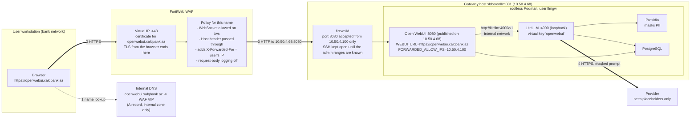

# Phase 9: Exposure through the WAF, openwebui.xalqbank.az

Until now both front-ends were reached through SSH tunnels. This phase puts Open WebUI
behind the bank's FortiWeb WAF under the name `openwebui.xalqbank.az` (D-33). The WAF is
the reverse proxy: it holds the certificate, terminates the users' TLS and forwards to
the server over plain HTTP on the WAF-to-server leg, which firewalld restricts to the
WAF's address. Nothing new runs on the server. `litellm.xalqbank.az` is the second step
of the same design and waits for the first developer key (D-33; docs/05 §5.10).

Addresses: server `10.50.4.68`, WAF source address as seen by the server `10.50.4.100`.



Where the prompt exists unmasked: the WAF (TLS ends there), Open WebUI's chat history
(D-30), LiteLLM before the Presidio call. Nothing outside the bank sees it.

## 8.1 Requirements on the WAF (owner of the WAF; no server access needed)

Configured on the FortiWeb for the name `openwebui.xalqbank.az`:

1. Virtual server on 443 with the certificate for `openwebui.xalqbank.az` issued by the
   WAF's CA, chain included, so that domain-joined browsers trust it without a prompt.
2. Server pool member `10.50.4.68:8080`, plain HTTP; health check `GET /health`,
   expecting HTTP 200 (the application answers `{"status":true}`).
3. The `Host` header is passed to the server unchanged (the application builds no
   absolute URLs from it, but it is the value the access logs show).
4. `X-Forwarded-For` set to the client's address on every request. If the WAF can add
   `X-Forwarded-Proto: https`, add it; the application trusts both headers from
   10.50.4.100 only (`FORWARDED_ALLOW_IPS` in the unit).
5. WebSocket allowed for `/ws/` (socket.io, mounted there in Open WebUI v0.11.3);
   without it the chat still works but falls back to polling.
6. Streaming: the server-side response timeout must exceed 600 s (LiteLLM
   `request_timeout`), and response buffering must be off for `/api/chat/completions`
   and `/api/v1/` so that tokens reach the browser as they arrive.
7. Request body size: at least 20 MB for document uploads (Open WebUI's own default
   upload limit is not set; the WAF's is the effective one).
8. Request-body logging off for this virtual server: the bodies are prompts and
   chat history in clear (D-33).
9. Optional: HTTP on 80 redirects to 443.

DNS: one A record `openwebui.xalqbank.az` pointing at the WAF's virtual IP, in the
internal zone only. The server's own address is not published under this name.

## 8.2 The unit (workstation, then service account)

Three lines changed in `deploy/opt/openwebui/llmgw-openwebui.container`:
`PublishPort=10.50.4.68:8080:8080`, `WEBUI_URL=https://openwebui.xalqbank.az`, and two
new variables `FORWARDED_ALLOW_IPS=10.50.4.100` and `WEBUI_SESSION_COOKIE_SECURE=true`
(both read by v0.11.3: `start.sh` passes the first to uvicorn as `--forwarded-allow-ips`,
whose default is `*`; `env.py` applies the second to the session cookie and, by
inheritance, the auth cookie). Transfer the file with the branch ZIP and `scp`
(docs/03 §3.4) and check it on the server:

```bash
infosec$ grep -c $'\r' /tmp/llmgw-openwebui.container; diff /opt/llm-gateway/openwebui/llmgw-openwebui.container /tmp/llmgw-openwebui.container
infosec$ sudo install -m 644 -o llmgw -g llmgw /tmp/llmgw-openwebui.container /opt/llm-gateway/openwebui/llmgw-openwebui.container && rm /tmp/llmgw-openwebui.container
```

CRLF count 0; the diff shows the `PublishPort=`, `WEBUI_URL=` lines, the two new
variables and their comments, and the header comment, nothing else. Then, as `llmgw`
(`sudo machinectl shell llmgw@`):

```bash
llmgw$ systemctl --user daemon-reload && systemctl --user restart llmgw-openwebui.service
llmgw$ podman ps --format '{{.Names}}\t{{.Status}}'
llmgw$ podman port openwebui
```

All five containers healthy; `podman port` shows `8080/tcp -> 10.50.4.68:8080`. From the
admin account, `sudo ss -tlnp | grep ':8080 '` shows the socket on 10.50.4.68, no longer
on 127.0.0.1. The SSH tunnel to 8080 stops working at this point; the LiteLLM tunnel to
4000 is unaffected.

## 8.3 firewalld (admin account)

This is the docs/02 §2.7 step, executed now. The admin ranges for SSH are still
unknown (docs/01 §1.14 question 5), so the `ssh` service stays allowed from anywhere,
which is what the host does today without a firewall; the SSH rich rules of §2.7 follow
when the ranges are known. The Zabbix rule from §2.7 is included so that monitoring
keeps working. Port 8080 is accepted from the WAF only.

```bash
sudo systemctl enable --now firewalld
sudo firewall-cmd --get-default-zone                    # public
sudo firewall-cmd --permanent --zone=public --remove-service=cockpit
sudo firewall-cmd --permanent --zone=public --remove-service=dhcpv6-client
sudo firewall-cmd --permanent --zone=public --add-rich-rule='rule family="ipv4" source address="10.100.7.150/32" port port="10050" protocol="tcp" accept'
sudo firewall-cmd --permanent --zone=public --add-rich-rule='rule family="ipv4" source address="10.50.4.100/32" port port="8080" protocol="tcp" accept'
sudo firewall-cmd --reload && sudo firewall-cmd --list-all
```

`--list-all` shows `services: ssh`, the two rich rules, no `ports:`. The rule does not
affect traffic the host sends to itself (firewalld accepts the loopback interface), so
`curl -sS http://10.50.4.68:8080/health` from the server still answers; the test of the
rule is from the workstation:

```
curl.exe -sS -m 5 http://10.50.4.68:8080/health
```

must fail (the `public` zone rejects with "No route to host" or times out), while the
WAF's health check turns the pool member green once 8.1 is in place.

## 8.4 Round trip (workstation, browser)

1. `https://openwebui.xalqbank.az/` shows the login page with a valid certificate (the
   padlock names the WAF's CA), no warning.
2. Log in as the admin, send the docs/07 §7.6 name test; the answer streams token by
   token (buffering off on the WAF) and the placeholders come back restored.
3. Admin Panel, Settings, General shows the WebUI URL as `https://openwebui.xalqbank.az`.
4. On the server, the request arrived from the WAF, the user's address in the header:

   ```bash
   sudo journalctl _SYSTEMD_USER_UNIT=llmgw-openwebui.service --since -5m | grep -E '"(GET|POST) ' | tail -3
   ```

   uvicorn's access lines show the client address from `X-Forwarded-For` (the
   workstation's address), not 10.50.4.100, which proves `FORWARDED_ALLOW_IPS` works.
5. Sign out and in again: the cookie is accepted (Secure flag, HTTPS).

## 8.5 Exit criteria and what comes next

- 8.2 to 8.4 pass; results recorded below.
- The tunnel to 8080 is retired from docs/07 §7.6 for daily use; the LiteLLM admin UI
  keeps its tunnel (docs/05 §5.8).

Next, in this order: `litellm.xalqbank.az` when the first developer key exists (same
steps with port 4000, `general_settings.use_x_forwarded_for: true` in `config.yaml`, and
the WAF exposing `/v1/` only), the SSH rich rules once the admin ranges are known
(docs/02 §2.7), the egress policy (docs/02 §2.8), Active Directory login.

## Results

Not yet run.
