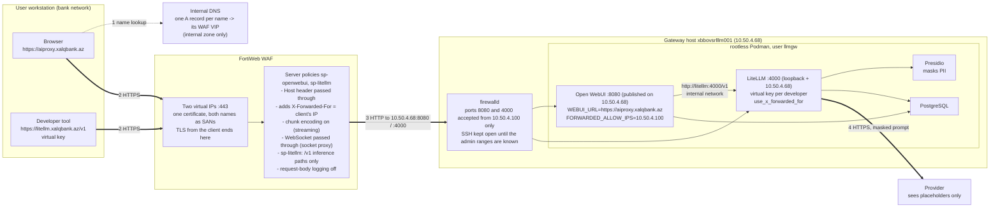

# Phase 9: Exposure through the WAF, aiproxy.xalqbank.az and litellm.xalqbank.az

Until now both front-ends were reached through SSH tunnels. This phase puts them behind
the bank's FortiWeb WAF: Open WebUI as `aiproxy.xalqbank.az` for the users, LiteLLM as
`litellm.xalqbank.az` for developer tools with a virtual key each (D-33; the LiteLLM
name was added on request on 2026-09-18, docs/05 §5.10). The WAF is the reverse proxy:
it holds the certificate, terminates the TLS and forwards to the server over plain HTTP
on the WAF-to-server leg, which firewalld restricts to the WAF's address. For LiteLLM the
WAF passes the inference paths only (`/v1/chat/completions`, `/v1/models`, ...); the
admin UI and the management API stay on the SSH tunnel. Nothing new runs on the server.

Addresses: server `10.50.4.68`; WAF address `10.50.4.100`, meaning the FortiWeb interface
from which it opens the connections to the server (in Reverse Proxy mode the source of the
server-side connection is a FortiWeb interface address, not the virtual IP the users
reach). §8.3 checks this on the server.



Where the prompt exists unmasked: the WAF (TLS ends there), Open WebUI's chat history
(D-30), LiteLLM before the Presidio call. Nothing outside the bank sees it.

## 8.1 The WAF (FortiWeb web UI, then two CLI lines)

Verified 2026-09-18 against the FortiWeb 7.6.7 Administration Guide and the 7.4.5 CLI
Reference (Fortinet's PDFs; the object names and menu paths below are theirs). The
firmware on the bank's unit is read from System > Status before starting; the 7.x
releases share these menus. Everything is built as separate objects first and tied
together by the server policy last, which is the order the guide prescribes. Object
names are proposals.

What the objects give, in one list: TLS on 443 with the bank's certificate and chain,
plain HTTP to `10.50.4.68:8080` with a `GET /health` check, the `Host` header passed
through, `X-Forwarded-For` and `X-Forwarded-Proto` set by the WAF alone, WebSocket
passed through (FortiWeb "acts as a pure socket proxy for WebSocket traffic"), streamed
answers forwarded chunk by chunk, 20 MB request bodies, no request-body logging.

**Before touching the WAF, three things from other teams**

- A free address on the FortiWeb's client-facing subnet for the virtual IP (it must not
  be an interface address). The DNS A record points at it later.
- The bank CA signs a server certificate for `aiproxy.xalqbank.az` from a CSR (step 7).
- Confirmation that the FortiWeb runs in Reverse Proxy mode (System > Config >
  Operation). It does if it already publishes other applications this way. Never change
  the mode for this project: switching deletes the policies of the old mode.

**Step 1, virtual IP.** Network > Virtual IP > Create New: Name `vip-openwebui`, IPv4
Address = the allocated address with its mask, Interface = the client-facing port. Only a
global administrator can create VIPs.

**Step 2, virtual server.** Server Objects > Server > Virtual Server > Create New, Name
`vs-openwebui`, OK; then Create New inside it: Use Interface IP off, Virtual IP
`vip-openwebui`, Status enabled, OK. The listening port is not set here but by the
service chosen in the server policy (step 10).

**Step 3, health check.** Server Objects > Server > Health Check > Create New: Name
`hc-openwebui`, Relationship And, OK; rule: Type HTTP, URL Path `/health`, Method GET,
Match Type Response Code, Response Code `200`, Timeout 3, Retry Times 3, Interval 10
(the guide's defaults; interval between 6 and 9 s is its recommendation for timeout 3
and 2 retries, 10 is fine). Open WebUI answers `{"status":true}` with 200 (docs/07).

**Step 4, server pool.** Server Objects > Server > Server Pool > Create New > Create HTTP
Server Pool: Name `pool-openwebui`, Type follows the operation mode (Reverse Proxy),
Single Server/Server Balance = **Server Balance**, Server Health Check `hc-openwebui`,
Load Balancing Algorithm Round Robin, Persistence none, OK. Server Balance with one
member is chosen because the guide offers the health check (pool and member level)
only for Server Balance pools; a Single Server pool has no health check and the Policy
Status dashboard shows nothing for it. Then Create New member: Status Enable, Server
Type IP, IP `10.50.4.68`, Port `8080`, SSL off, HTTP/2 off, Proxy Protocol off, Inherit
Health Check on, Backup Server off, OK. The member shows down until §8.3 is done on the
server; that is expected.

**Step 5, protected hostname.** Server Objects > Protected Hostnames > Create New: Name
`ph-openwebui`, Default Action Deny, OK; Create New entry: Host `aiproxy.xalqbank.az`,
Ignore Port off, Override Headers off, Action Accept, OK. Requests whose `Host` is not
this name are rejected before reaching the server (the attack log then shows
`HTTP Host Violation`).

**Step 6, X-header rule.** Server Objects > X-Forwarded-For > Create New: Name
`xff-openwebui`; Add X-Forwarded-For **on**; Add Source Port off; Add X-Forwarded-Port
off; Add X-Real-IP off; Add X-Forwarded-Proto **on**; Delete Previous XFF Headers
**on** (the request then carries exactly one `X-Forwarded-For` with one address,
written by the WAF, so a client cannot pre-load the header); Merge Previous XFF Headers
off; Use X-Header to Identify Original Client's IP **off** (the users connect to the
WAF directly, nothing applies NAT in front of it), OK. The rule takes effect only when
selected in the protection profile (step 9).

**Step 7, certificate.** Server Objects > Certificates > Local > Generate: Certification
Name `aiproxy.xalqbank.az`, ID Type Domain Name, Domain Name `aiproxy.xalqbank.az`,
Organization and Country as the bank's PKI requires, Subject Alternative Names
`aiproxy.xalqbank.az` and `litellm.xalqbank.az` (one certificate serves both server
policies and is renewed once), Key Type RSA, Key Size 2048 Bit, Digest Algorithm SHA256,
Enrollment Method File Based, OK. Select the PENDING row, Download, and submit the
`.csr` to the bank CA (server authentication). The private key stays on the WAF. When
the signed certificate (PEM) comes back: Local > Import, Type **Local Certificate**
(the CSR was generated here, so no key file is asked), Certificate file = the signed
certificate, OK; the row turns from PENDING to a certificate. If the issuing CA is an
intermediate, upload its certificate (or one PEM file holding the whole chain in order,
issuer first) under Server Objects > Certificates > Intermediate CA > Import > Local PC,
then on the Intermediate CA Group tab create `ca-group-bank` and add it. If the PKI
team prefers to issue certificate and key themselves as a PKCS#12 file, Import with
Type PKCS12 Certificate and its password instead of the CSR route.

**Step 8, protocol constraints.** Web Protection > Protocol > HTTP Protocol
Constraints: clone the predefined profile into `hpc-openwebui` and edit: Body Length
enabled with `20971520` (20 MB, document uploads; the effective upload limit, Open WebUI
sets none), Content Length `20971520`, HTTP Request Length not lower than that if it is
enabled; **WebSocket Protocol must stay off** (that constraint detects and, with a deny
action, blocks WebSocket upgrades; socket.io lives under `/ws/`); Illegal HTTP Version
on (HTTP/1.1 is what the browsers use once HTTP/2 stays off in step 10).

**Step 9, inline protection profile.** Policy > Web Protection Profile > Inline
Protection Profile: clone a predefined profile into `wpp-openwebui` and set: Signatures
= the signature set the clone brought; HTTP Protocol Constraints `hpc-openwebui`;
X-Forwarded-For `xff-openwebui`; WebSocket Security empty (a security policy is
optional; without one the WAF proxies the socket); Bot Mitigation Policy **empty** (its
Slow Attack Detection carries a 60 s HTTP transaction timeout by default, which would
cut long answers); Client Management off; Allow Method, URL Access, Custom Policy, JSON
Protection empty for now. Everything else as cloned.

**Step 10, server policy.** Policy > Server Policy > Create New:

- Network Configuration: Policy Name `sp-openwebui`; Deployment Mode Single
  Server/Server Balance; Virtual Server `vs-openwebui`; Server Pool `pool-openwebui`;
  Protected Hostnames `ph-openwebui`; Client Real IP **off** (the server must see the
  WAF's address, §8.3 depends on it); HTTP Service `HTTP` only if the redirect below is
  wanted; HTTPS Service `HTTPS`; HTTP/2 **off** (default; HTTP/2 bypasses the WebSocket
  services and is the setting behind the reported hangs of `text/event-stream`
  responses); Certificate Type Local, Certificate `aiproxy.xalqbank.az`, Certificate
  Intermediate Group `ca-group-bank` if created.
- Advanced SSL settings: Supported SSL Protocols TLS 1.2 and TLS 1.3 only; SSL/TLS
  Encryption Level High; Disable Client-Initiated SSL Renegotiation on; Add HSTS Header
  on with Max. Age 31536000 (the guide requires a web protection profile on the policy
  for HSTS, which step 9 provides); Redirect HTTP to HTTPS on when the HTTP service is
  selected.
- Application Delivery: Retry On off; Web Cache off.
- Security Configuration: **Monitor Mode on for the burn-in** (see below); Syn Cookie
  off; Web Protection Profile `wpp-openwebui`; URL Case Sensitivity on.
- Log Config: Enable Traffic Log off. OK. The policy is enabled on creation.

**Step 11, streaming (CLI, the one setting the web UI does not show).** By default
FortiWeb decodes a chunked response and forwards it as one body with a
`Content-Length`, that is, the answer would reach the browser only when the model has
finished. `chunk-encoding enable` makes it forward the chunks as they arrive:

```
config server-policy policy
  edit "sp-openwebui"
    set chunk-encoding enable
  next
end
show server-policy policy sp-openwebui
```

`client-timeout`, `HTTP-header-timeout` and `tcp-recv-timeout` keep their default 0 (no
timeout), so a long generation is not cut by the policy.

**Step 12, checks on the WAF.** CLI `execute ping 10.50.4.68`, and after §8.3
`execute telnettest 10.50.4.68:8080` prints `Connected`; the Policy Status dashboard
shows the pool member up. Log & Report > Log Config > Other Log Settings: Enable Attack
Log on, traffic log stays off (`config log traffic-log`, `status` and `packet-log`
default to disable, nothing to change). Retain Packet Payload For: keep the defaults
during the burn-in, because the first 4 KB of a request that matched a signature is what
shows a false positive; once tuned, clear the Signatures entry so that prompt text stops
landing in the attack log (D-33).

**Burn-in.** Prompts contain SQL, shell and code fragments, which is exactly what the
signature set looks for in a request body, so false positives on `/api/chat/completions`
are expected. With Monitor Mode on, violations are logged (Log & Report > Log Access >
Attack) and nothing is blocked. After a week of use: add signature exceptions for the
matching URLs where the log shows them, then switch Monitor Mode off and re-test. The
WAF protections that matter for this application are the TLS termination, the host
restriction and the size limits; the signatures are a bonus to be tuned, not a reason to
block the users' chats.

**The second name, litellm.xalqbank.az (steps 13 to 19).** Same objects again with a
second virtual IP, plus one URL access policy that reduces what the WAF forwards to the
inference paths. Reused from the first name: the X-header rule `xff-openwebui`, the
constraints profile `hpc-openwebui` (20 MB is more than any prompt needs) and the
certificate of step 7, which carries both names.

**Step 13, virtual IP and virtual server.** Network > Virtual IP > Create New
`vip-litellm` with the second allocated address; Server Objects > Server > Virtual
Server > Create New `vs-litellm`, member: Virtual IP `vip-litellm`, Status enabled.

**Step 14, health check.** Server Objects > Server > Health Check > Create New
`hc-litellm`, rule Type HTTP, URL Path `/health/liveliness`, Method GET, Match Type
Response Code, `200`. The route is unauthenticated in 1.100.1 (it says so in
`proxy/health_endpoints/_health_endpoints.py`) and answers `"I'm alive!"`; the unit's own
health check uses it too.

**Step 15, server pool.** Server Objects > Server > Server Pool > Create New > Create
HTTP Server Pool `pool-litellm`, Server Balance, Server Health Check `hc-litellm`, Round
Robin, no persistence; member IP `10.50.4.68`, Port `4000`, SSL off, HTTP/2 off, Inherit
Health Check on.

**Step 16, protected hostname.** Server Objects > Protected Hostnames > Create New
`ph-litellm`, Default Action Deny; entry Host `litellm.xalqbank.az`, Action Accept.

**Step 17, URL access allowlist.** Web Protection > Access > URL Access, tab URL Access
Rule, Create New `uar-litellm-allow`: Action Pass; then Create New for each condition,
URL Type Regular Expression, Meet this condition if the request matches:

```
^/v1/(chat/completions|completions|embeddings|models|model/info|messages|messages/count_tokens)$
^/v1/responses(/[^/]+(/input_items|/cancel)?)?$
^/health/liveliness$
```

Test each expression with the `>>` validator next to the field. Second rule
`uar-litellm-deny`: Action Alert & Deny, Severity Medium, one condition `^/`. Then the
URL Access tab (the policy): Create New `uap-litellm`, add `uar-litellm-allow` first and
`uar-litellm-deny` second; rules at the top of the list have priority (use Move if the
order differs). Everything the allowlist does not name is answered by the WAF with its
block page and logged as `URL Access Violation`: `/ui/`, `/key/...`, `/user/...`,
`/model/...`, `/spend/...`, `/docs`, the MCP, agent, file and batch routes. The listed
paths are the OpenAI-format routes the developer tools use (chat and legacy completions,
embeddings, the Responses API with retrieve, input items and cancel), the model list
(`/v1/models` needs a virtual key, `/v1/model/info` shows the key's models), and the
Anthropic-format routes `/v1/messages` and `/v1/messages/count_tokens` for tools that
speak that dialect. All of them require a virtual key inside LiteLLM; only the health
route answers without one.

**Step 18, inline protection profile.** Clone `wpp-openwebui` into `wpp-litellm` and set
URL Access `uap-litellm`; leave **Signatures empty** on this profile for now: the API
carries key-authenticated JSON only, prompts contain SQL and code, and unlike the
Open WebUI policy this one cannot run in Monitor Mode (step 19). Signatures can be
added once the exceptions learned on `sp-openwebui` are known.

**Step 19, server policy and streaming.** Policy > Server Policy > Create New
`sp-litellm` exactly as step 10 with `vs-litellm`, `pool-litellm`, `ph-litellm`,
`wpp-litellm`, the same certificate and intermediate group, no HTTP service, and
**Monitor Mode off**: the guide states that Monitor Mode ignores the URL access actions,
so with it on the allowlist would not be enforced and `/ui/` would be reachable. Then the
same CLI lines as step 11 for `sp-litellm` (`set chunk-encoding enable`), and
`execute telnettest 10.50.4.68:4000` after §8.3.

**DNS.** Two A records, `aiproxy.xalqbank.az` to the virtual IP of step 1 and
`litellm.xalqbank.az` to the one of step 13, in the internal zone only, created after
step 12 passes. The server's own address is not published under these names.

## 8.2 The units (workstation, then service account)

Order: §8.3 runs before this section. From the restart on, both ports listen on the
host address, and until firewalld is up any host on the network reaches them; with the
rich rules in place first there is no such window. The section numbers stay as the
units and DECISIONS.md cite them.

Open WebUI first. Three lines changed in `deploy/opt/openwebui/llmgw-openwebui.container`:
`PublishPort=10.50.4.68:8080:8080`, `WEBUI_URL=https://aiproxy.xalqbank.az`, and two
new variables `FORWARDED_ALLOW_IPS=10.50.4.100` and `WEBUI_SESSION_COOKIE_SECURE=true`
(both read by v0.11.3: `start.sh` passes the first to uvicorn as `--forwarded-allow-ips`,
whose default is `*`; `env.py` applies the second to the session cookie and, by
inheritance, the auth cookie). Transfer the file with the branch ZIP and `scp`
(docs/03 §3.4) and check it on the server:

```bash
infosec$ grep -c $'\r' /tmp/llmgw-openwebui.container; sudo diff /opt/llm-gateway/openwebui/llmgw-openwebui.container /tmp/llmgw-openwebui.container
infosec$ sudo install -m 644 -o llmgw -g llmgw /tmp/llmgw-openwebui.container /opt/llm-gateway/openwebui/llmgw-openwebui.container && rm /tmp/llmgw-openwebui.container
```

CRLF count 0; the diff shows the `PublishPort=`, `WEBUI_URL=` lines, the two new
variables and their comments, and the header comment, nothing else. Then, as `llmgw`
(`sudo machinectl shell llmgw@`):

```bash
llmgw$ systemctl --user daemon-reload && systemctl --user restart llmgw-openwebui.service
llmgw$ podman ps --format '{{.Names}}\t{{.Status}}'
llmgw$ podman port openwebui
```

All five containers healthy; `podman port` shows `8080/tcp -> 10.50.4.68:8080`. From the
admin account, `sudo ss -tlnp | grep ':8080 '` shows the socket on 10.50.4.68, no longer
on 127.0.0.1. The SSH tunnel to 8080 stops working at this point; the LiteLLM tunnel to
4000 is unaffected.

Then LiteLLM: two files. `deploy/opt/litellm/llmgw-litellm.container` gains a second
`PublishPort=10.50.4.68:4000:4000` line next to the loopback one (Quadlet accepts the
key several times; the dry-run renders `--publish 127.0.0.1:4000:4000 --publish
10.50.4.68:4000:4000`), so the admin tunnel of docs/05 §5.8 keeps working unchanged.
`deploy/opt/litellm/config.yaml` gains `use_x_forwarded_for: true` under
`general_settings`: the client address stored with each request (`requester_ip_address`
in `LiteLLM_SpendLogs`, docs/06 §6.7) becomes the `X-Forwarded-For` value, which the WAF
writes and only the WAF can deliver. Same transfer and check:

```bash
infosec$ grep -c $'\r' /tmp/llmgw-litellm.container /tmp/config.yaml
infosec$ sudo diff /opt/llm-gateway/litellm/llmgw-litellm.container /tmp/llmgw-litellm.container; sudo diff /opt/llm-gateway/litellm/config.yaml /tmp/config.yaml
infosec$ sudo install -m 644 -o llmgw -g llmgw /tmp/llmgw-litellm.container /opt/llm-gateway/litellm/llmgw-litellm.container && sudo install -m 644 -o llmgw -g llmgw /tmp/config.yaml /opt/llm-gateway/litellm/config.yaml && rm /tmp/llmgw-litellm.container /tmp/config.yaml
```

Counts 0 and 0; the unit diff shows the header line, the `PublishPort` comment and the
added line; the config diff shows the `use_x_forwarded_for` block only (mode 644 is the
one docs/05 §5.3 and docs/07 §7.2 used for this file). Then, as `llmgw`:

```bash
llmgw$ systemctl --user daemon-reload && systemctl --user restart llmgw-litellm.service
llmgw$ podman ps --format '{{.Names}}\t{{.Status}}'
llmgw$ podman port litellm
```

Restarting LiteLLM restarts Open WebUI's upstream only; Open WebUI itself stays up. All
five healthy; `podman port litellm` prints two lines, `4000/tcp -> 127.0.0.1:4000` and
`4000/tcp -> 10.50.4.68:4000`; `sudo ss -tlnp | grep ':4000 '` shows both sockets.

## 8.3 firewalld (admin account, before §8.2)

This is the docs/02 §2.7 step, executed now, before the units of §8.2 are restarted.
firewalld is installed but inactive on the host; `firewall-offline-cmd --zone=public
--list-all` shows the zone before it is switched on (`services: cockpit dhcpv6-client
ssh`), which confirms the SSH session survives the start. The admin ranges for SSH are still
unknown (docs/01 §1.14 question 5), so the `ssh` service stays allowed from anywhere,
which is what the host does today without a firewall; the SSH rich rules of §2.7 follow
when the ranges are known. The Zabbix rule from §2.7 is included so that monitoring
keeps working. Ports 8080 and 4000 are accepted from the WAF only.

```bash
sudo systemctl enable --now firewalld
sudo firewall-cmd --get-default-zone                    # public
sudo firewall-cmd --permanent --zone=public --remove-service=cockpit
sudo firewall-cmd --permanent --zone=public --remove-service=dhcpv6-client
sudo firewall-cmd --permanent --zone=public --add-rich-rule='rule family="ipv4" source address="10.100.7.150/32" port port="10050" protocol="tcp" accept'
sudo firewall-cmd --permanent --zone=public --add-rich-rule='rule family="ipv4" source address="10.50.4.100/32" port port="8080" protocol="tcp" accept'
sudo firewall-cmd --permanent --zone=public --add-rich-rule='rule family="ipv4" source address="10.50.4.100/32" port port="4000" protocol="tcp" accept'
sudo firewall-cmd --reload && sudo firewall-cmd --list-all
```

`--list-all` shows `services: ssh`, the three rich rules, no `ports:`. The rule does not
affect traffic the host sends to itself (firewalld accepts the loopback interface), so
`curl -sS http://10.50.4.68:8080/health` from the server still answers; the test of the
rule is from the workstation:

```
curl.exe -sS -m 5 http://10.50.4.68:8080/health
curl.exe -sS -m 5 http://10.50.4.68:4000/health/liveliness
```

both must fail (the `public` zone rejects with "No route to host" or times out), while the
WAF's health checks turn the pool members up once §8.1 steps 4 and 15 are in place.

If the member stays down, the WAF is not connecting from 10.50.4.100. firewalld can say
which address it is: enable the denied-packet log, wait one health check interval,
read the kernel log, then switch the log off again:

```bash
sudo firewall-cmd --set-log-denied=unicast
sudo journalctl -k --since -1m -g 'DPT=(8080|4000)' | tail -3
sudo firewall-cmd --set-log-denied=off
```

The `SRC=` field of a logged line is the FortiWeb interface address actually used; if
it differs from 10.50.4.100, the rich rule and `FORWARDED_ALLOW_IPS` in the unit (§8.2)
are corrected to that address, not the other way round.

## 8.4 Round trip (workstation, browser)

1. `https://aiproxy.xalqbank.az/` shows the login page with a valid certificate (the
   padlock names the WAF's CA), no warning.
2. Log in as the admin, send the docs/07 §7.6 name test; the answer streams token by
   token (`chunk-encoding enable`, §8.1 step 11) and the placeholders come back restored.
3. Admin Panel, Settings, General shows the WebUI URL as `https://aiproxy.xalqbank.az`.
4. On the server, the request arrived from the WAF, the user's address in the header:

   ```bash
   sudo journalctl _SYSTEMD_USER_UNIT=llmgw-openwebui.service --since -5m | grep -E '"(GET|POST) ' | tail -3
   ```

   uvicorn's access lines show the client address from `X-Forwarded-For` (the
   workstation's address), not 10.50.4.100, which proves `FORWARDED_ALLOW_IPS` works.
5. Sign out and in again: the cookie is accepted (Secure flag, HTTPS).

LiteLLM round trip (workstation, then server). The virtual key goes into a header file
written in Notepad, never on the command line: `hdr.txt` with the single line
`Authorization: Bearer <the docs/05 test key, which has mock-echo>`; delete the file afterwards.

```
curl.exe -sS https://litellm.xalqbank.az/health/liveliness
curl.exe -sS -o NUL -w "%{http_code}\n" https://litellm.xalqbank.az/ui/
curl.exe -sS -o NUL -w "%{http_code}\n" https://litellm.xalqbank.az/key/info
curl.exe -sS https://litellm.xalqbank.az/v1/models -H @hdr.txt
curl.exe -sS -N https://litellm.xalqbank.az/v1/chat/completions -H @hdr.txt -H "Content-Type: application/json" -d "{\"model\":\"mock-echo\",\"stream\":true,\"messages\":[{\"role\":\"user\",\"content\":\"Dennis Yurichev, card 5555 5555 5555 4444\"}]}"
del hdr.txt
```

Expected: `"I'm alive!"`; `403` twice (the WAF's block page, and Log & Report > Log
Access > Attack shows `URL Access Violation` for both); the key's model list; SSE
chunks arriving as a stream with the echo (masking applies as in docs/05 §5.4). On the
server, the request is attributed to the workstation, not to the WAF:

```bash
llmgw$ podman exec postgres psql -U litellm -d litellm -tAc "select \"startTime\", model, requester_ip_address from \"LiteLLM_SpendLogs\" order by \"startTime\" desc limit 3"
```

The newest row shows the workstation's address (`use_x_forwarded_for`); rows from Open
WebUI show the container network address of Open WebUI, as before.

## 8.5 Exit criteria and what comes next

- 8.2 to 8.4 pass; results recorded below.
- The tunnel to 8080 is retired from docs/07 §7.6 for daily use; the LiteLLM admin UI
  keeps its tunnel (docs/05 §5.8).

- Developer keys are issued per person as in docs/06 §6.6; the base URL handed out is
  `https://litellm.xalqbank.az/v1`. Until the Gemini key exists, every key shares the
  free tier's 50 requests per day (D-31), so one coding assistant can exhaust it.

Next, in this order: the SSH rich rules once the admin ranges are known (docs/02 §2.7),
the egress policy (docs/02 §2.8), Active Directory login, signatures on `sp-litellm`
once the exceptions learned on `sp-openwebui` are known.

## Results

**2026-09-18, server side (§8.3 then §8.2), all as expected.** The three files were
copied from the branch ZIP at commit 8a2b744 (sizes 5931, 3668 and 6596 bytes, CRLF
count 0 each); `sudo diff` showed the planned lines plus two comment-only hunks from
earlier commits that had never been installed (the health-check comment in the Open WebUI
unit, the UI-directory comment in the LiteLLM unit). firewalld 2.4.3-4.el10_2 was
enabled first: zone `public` active on `ens33`, `services: ssh`, no ports, the three
rich rules (10050 from 10.100.7.150, 8080 and 4000 from 10.50.4.100). Then the installs
(mode 644, owner `llmgw`), `daemon-reload`, `restart llmgw-litellm.service`, and once
LiteLLM was healthy `restart llmgw-openwebui.service`; all five containers healthy.
`podman port` prints `4000/tcp -> 127.0.0.1:4000`, `4000/tcp -> 10.50.4.68:4000` and
`8080/tcp -> 10.50.4.68:8080`; `ss -tlnp` shows the same three sockets, all owned by
`rootlessport`. From the host, `/health` answers `{"status":true}` and
`/health/liveliness` answers `"I'm alive!"`; from the workstation both requests time out
after 5 s (firewalld). The SSH tunnel to 8080 is retired; the one to 4000 still works.

**2026-09-18, WAF-to-server reachability.** From the FortiWeb CLI, `execute telnettest
10.50.4.68:8080` connects and `execute telnettest 10.50.4.68:4000` times out, although
both ports have the same firewalld rich rule and both sockets answer from the host. To
rule out the port number, a runtime-only rich rule for 8000 and a throwaway listener
(`python3 -m http.server 8000 --bind 10.50.4.68`) were put up for one test: 8000 times
out the same way; rule and listener removed, the three permanent rules confirmed. So a
device on the path between the FortiWeb and the server permits 8080 only; the server
side is not involved (a firewalld rejection would need a different source address, and
8080 proves the address). Port 4000 stays; the network team is asked to permit TCP 4000
from the FortiWeb's server-side address to 10.50.4.68. The Open WebUI objects (§8.1
steps 1 to 12) do not depend on it and proceed meanwhile.

Still to run: §8.1 (WAF steps 1 to 19, DNS) and §8.4.
